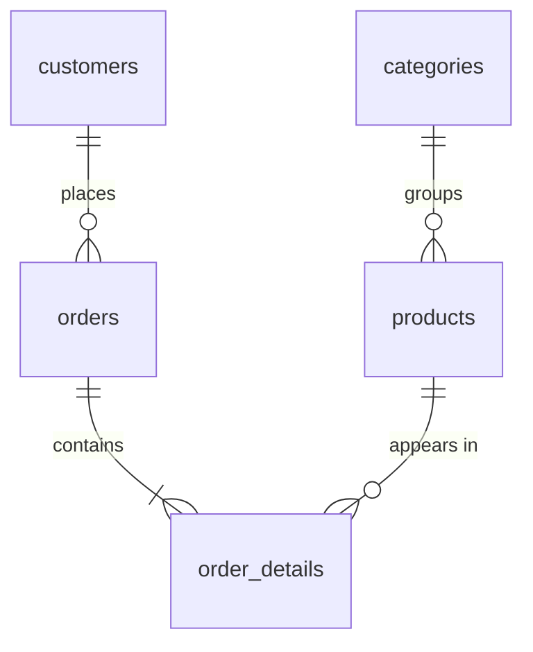
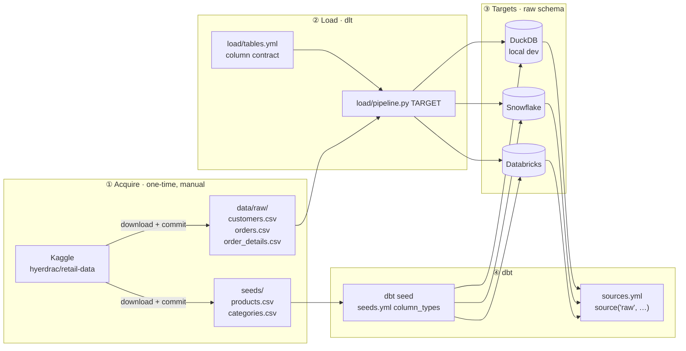
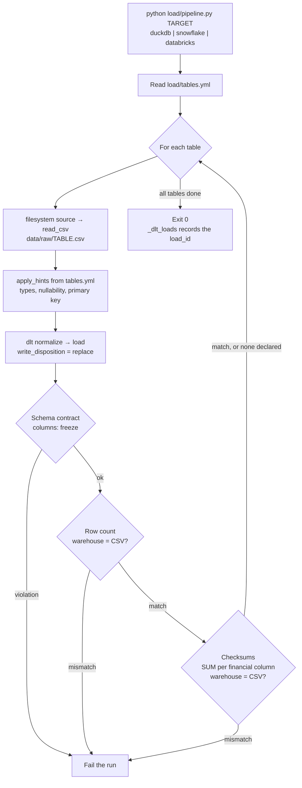

# Design 01: Data loading

Status: **revision 3**. D1–D9 are settled. The data has been acquired and profiled (section 8). No pipeline code yet.

Scope: everything from the Kaggle download up to `source('raw', ...)` being queryable in dbt, on all three targets. Staging models and anything after them are out of scope.

Dataset: [hyerdrac/retail-data](https://www.kaggle.com/datasets/hyerdrac/retail-data), synthetic retail data. The license allows redistribution.

## 1. Source model



| Table | Loaded by | Grain | Key |
|---|---|---|---|
| `customers` | dlt | one row per customer | `customer_id` |
| `orders` | dlt | one row per order | `order_id` |
| `order_details` | dlt | one row per order line | (`order_id`, `product_id`) |
| `products` | dbt seed | one row per product | `product_id` |
| `categories` | dbt seed | one row per category | `category_id` |

## 2. End-to-end flow



## 3. One pipeline run



## 4. Column contract (`load/tables.yml`)

This is the shape of the contract. The full file is written in the code step. dlt normalizes PascalCase headers to snake_case, so `CustomerID` becomes `customer_id`. I'll confirm that on the first DuckDB run.

```yaml
order_details:
  file: order_details.csv
  primary_key: [order_id, product_id]
  columns:
    order_id:      {data_type: text, nullable: false}
    product_id:    {data_type: text, nullable: false}
    quantity:      {data_type: bigint, nullable: false}
    unit_cost:     {data_type: decimal, precision: 18, scale: 2}   # data scale: 2
    unit_price:    {data_type: decimal, precision: 18, scale: 2}   # data scale: 2
    discount_rate: {data_type: decimal, precision: 5,  scale: 4}   # data scale: 2, headroom kept
    is_returned:   {data_type: bigint, precision: 16}              # smallint
    return_date:   {data_type: date}
    return_time:   {data_type: text}                               # D8
    return_reason: {data_type: text}
  checksums: [quantity, unit_cost, unit_price, discount_rate]
```

`customers` and `orders` follow the same pattern. `orders.order_time` follows D8.

**Checksums:** for each column listed under `checksums`, the pipeline sums the CSV in Python `Decimal` at the declared scale. It then runs `SELECT SUM(col)` on the target, and the two must match exactly. Using decimals instead of floats is what makes an exact match possible. The check is generic, but only `order_details` declares checksums.

## 5. Decisions

### Settled

| # | Decision | Outcome |
|---|---|---|
| D1 | CSV location | **Local checkout.** The `bucket_url` for dlt's filesystem source is one config value, so pointing it at a hosted bucket later is a one-line change. |
| D2 | Where types are declared | **`tables.yml` applied through `apply_hints(columns=...)`.** See the note below. |
| D3 | Write mode | **`replace`**. The data is static, and this project shows analytics engineering, not data engineering. |
| D4 | Seed location | **`raw` schema**, plus a `generate_schema_name` override. See the note below. |
| D5 | DuckDB location | `.local/dev.duckdb`, gitignored |
| D6 | Guardrails | Freeze the schema contract, compare row counts, **and checksum the financial columns of `order_details`** |
| D7 | Column naming | **UPPER_SNAKE.** See the note below. |
| D8 | Time columns | **`text` on every target.** Databricks has no `TIME` type. Staging combines date and time into timestamps (`ordered_at`, `returned_at`). |
| D9 | Decimal precision and scale | **Money is `decimal(18,2)`. `discount_rate` is `decimal(5,4)`.** The data's maximum scale is 2 for all three columns (section 8). |

**D2 note: what dlt recommends.** dlt doesn't rank its options. Its primary way to declare types is column hints on a resource (`columns=`, or `apply_hints()` before extraction), given as a dict or a Pydantic model. Its import/export schema YAML is meant for adjusting a schema dlt has already inferred, and the docs say to "keep the import schema as simple as possible." So column hints are the idiomatic choice. `tables.yml` just holds those hints as data instead of Python. For reading the files, I've switched to dlt's built-in `filesystem` source with `read_csv` instead of hand-written pandas, which means less code and more standard dlt usage.

**D4 note: why the override matters.** By default, dbt doesn't use a custom schema name as given. It prepends the target's schema. If your profile's schema is `dev` and the seeds are configured with `+schema: raw`, dbt creates `dev_raw`, which is not the `raw` schema where dlt put the other three tables. The standard fix is a five-line `generate_schema_name` macro that uses the custom name as written. The same macro later gives the clean `staging`, `marts` and `semantic` schemas from the project plan, so it's needed either way.

**D7 note: how UPPER_SNAKE is achieved.** Identifiers in SQL are always written unquoted. Snowflake stores unquoted names in upper case, so they show up there as UPPER_SNAKE. For the three source tables, nothing extra is needed: dlt normalizes headers to snake_case, and its Snowflake destination stores identifiers in upper case. For the seeds, the CSV headers were rewritten to UPPER_SNAKE (`PRODUCT_ID`, `CATEGORY_ID`), and `quote_columns: false` will be set in `seeds.yml`. On the other targets, Databricks always lowercases table names, and DuckDB keeps names in whatever case they were created. Both treat unquoted names as case-insensitive, so `product_id`, `PRODUCT_ID` and `Product_Id` all resolve to the same column, and models stay portable. The cost: on DuckDB and Databricks, the dlt tables display in lower case while the seeds display in upper case. Getting the same display case everywhere would mean quoting identifiers, which breaks portability.

## 6. Files this introduces

```
data/raw/            # customers.csv, orders.csv, order_details.csv
seeds/               # products.csv, categories.csv (+ seeds.yml in the dbt step)
load/
  pipeline.py        # argparse, loop over tables.yml, row-count + checksum checks
  tables.yml         # column contract
.dlt/config.toml     # non-secret config; secrets via env vars / gitignored secrets.toml
pyproject.toml       # uv-managed: dlt[duckdb,snowflake,databricks,filesystem]
```

## 7. Proposed next turns

1. ~~**Acquire:** move the seeds into `seeds/` with UPPER_SNAKE headers and profile the data.~~ Done.
2. **Scaffold:** `pyproject.toml` with uv, plus `tables.yml`. Review the contract on its own.
3. **Pipeline:** `pipeline.py` against DuckDB only, with its checks.
4. **dbt init:** `profiles.yml` for DuckDB, the `generate_schema_name` override, `seeds.yml` and `sources.yml`.

## 8. Data profile

| File | Rows | Notes |
|---|---|---|
| `data/raw/customers.csv` | 1,000 | 3 genders, 10 cities, 5 regions, 3 segments. `age` 18–72. Sign-ups 2020-01-03 to 2023-04-12. |
| `data/raw/orders.csv` | 10,000 | 1,000 customers. Orders 2021-01-01 to 2026-06-01. Order times 08:00–23:00. |
| `data/raw/order_details.csv` | 30,271 | 100 products, 1 to 8 lines per order. `quantity` 1–25. 1,424 lines returned (4.7%). |
| `seeds/products.csv` | 100 | 10 per category |
| `seeds/categories.csv` | 10 | |

**Integrity:** no empty values in any column, no duplicate primary keys and no orphaned foreign keys in any table. Every order has at least one line, and no unit price is below its unit cost.

**File format:** all files had a UTF-8 byte-order mark (BOM) and CRLF line endings.
- The source files are kept **exactly as downloaded**. The pipeline will read them with `encoding="utf-8-sig"`, which strips the BOM.
- The seeds are files we own, so they were rewritten as UTF-8 without a BOM, with LF line endings and UPPER_SNAKE headers. Values are unchanged.

**Sentinels in `order_details`:** lines that were not returned use `return_date = 9999-12-31`, `return_time = 00:00:00` and `return_reason = 'None'` (the string, not a null). They match `is_returned = 0` exactly, on both sides. Raw keeps them as they are. **Staging converts them to NULL.**

**Checksum baseline** (CSV, exact decimal):

| Column | SUM |
|---|---|
| `quantity` | 81,166 |
| `unit_cost` | 205,944.60 |
| `unit_price` | 296,471.84 |
| `discount_rate` | 1,121.80 |
