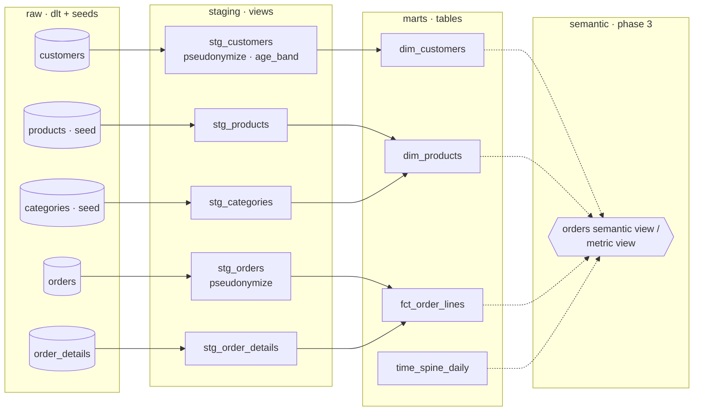
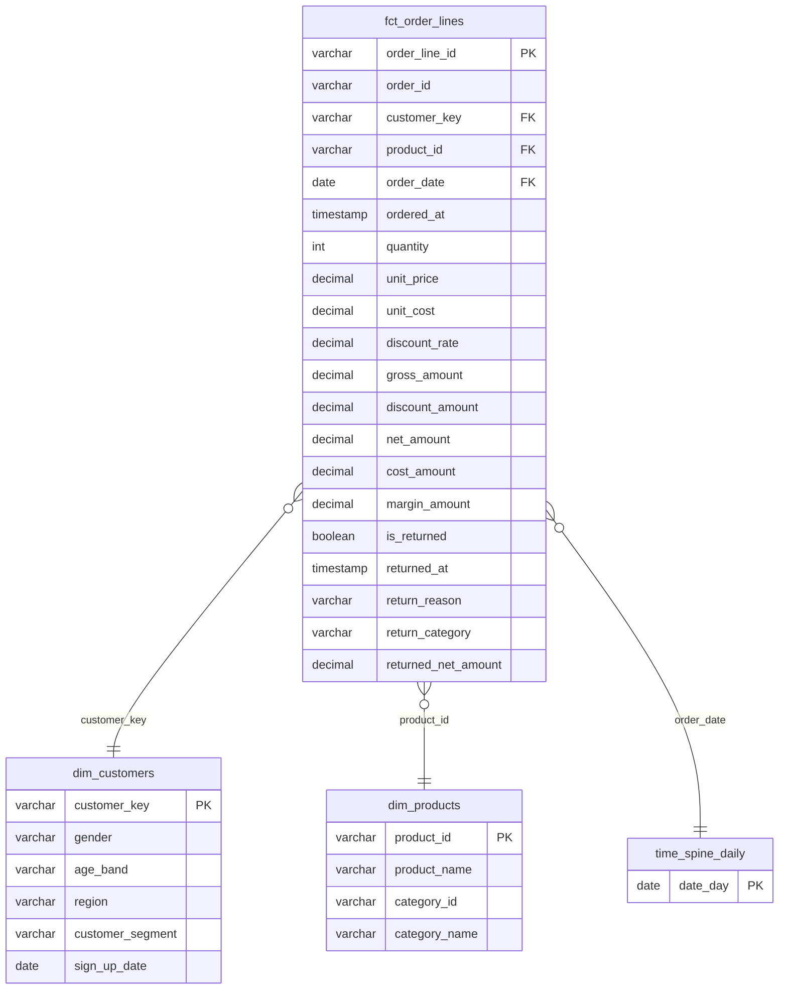

# Design 02: dbt models (and a sketch of the semantic layer)

Status: **revision 12. Phase 2 is complete:** B9 steps 1–4 are done, and 66 checks pass on DuckDB. E1–E10 are decided. Revision 12 adds E10: descriptions are written to the warehouse as comments. Revision 8 added `return_category` (B4, E9), recorded why the fact uses an inner join (B5), and closed out phase 2. Revision 9 dropped the return-category sort column and stated that `return_reason` is carried alongside the category. Revision 10 dropped `age_band_order` as well. Revision 11 drops `city` in staging (02A G10) and adds `return_category` to the marts diagram, where it had been missed. Phase 3 continues in [design 03](03-semantic-layer.md). Revision 3 follows 02A revision 2: no raw masks, and a scoped admin role. Governance, RBAC and ID masking are in the child doc [02A](02a-governance-rbac.md), and this doc includes their effects on phase 2.

Phases in this doc:

- **Phase 2 (proposed):** a dbt project on DuckDB covering seeds, sources, staging and marts, tested. The marts must also serve phase 3 and phase 4 without being reworked.
- **Phase 3 (sketch only):** one semantic definition, rendered as a Snowflake semantic view and a Databricks metric view.
- **Phase 4 (referenced only):** parity tests. They matter here because they define what "correct" means for the marts.

---

## A. Phase 3 sketch: the semantic layer

### A1. What each platform expects

These were checked against current docs and package source on 2026-11-12.

| | Snowflake semantic view | Databricks metric view |
|---|---|---|
| dbt support | `materialized='semantic_view'` from the `Snowflake-Labs/dbt_semantic_view` package | `materialized='metric_view'`, built into dbt-databricks since 1.12 |
| Model body | The SQL clauses `TABLES(...) RELATIONSHIPS(...) DIMENSIONS(...) METRICS(...)`, with tables referenced through `ref()` | **YAML** (`version: 1.1`, `source: ref(...)`, `joins`, `dimensions`, `measures`) |
| Joins | A `RELATIONSHIPS` entry from the fact's foreign key to the dimension's key. The dimension side **needs `PRIMARY KEY` declared** in `TABLES`, or Snowflake treats the relationship as many-to-many (in preview). | Star and snowflake joins are supported, but **joins must be many-to-one**. A many-to-many join silently takes the first matching row. |
| Time grains | Expressions on dimensions (`DATE_TRUNC`) | Expressions on dimensions (`DATE_TRUNC`). No built-in grain feature. |
| Query | `SEMANTIC_VIEW(sv METRICS ... DIMENSIONS ...)` | `MEASURE(m) ... GROUP BY` |

### A2. The single definition

The plan is dbt's own semantic YAML (`semantic_models` plus `metrics`). dbt parses and validates it, and it ends up in the dbt manifest. It's the standard dbt format, so it doesn't need a custom schema.

### A3. Where the generator lives (open, decided in phase 3)

| Option | How it works | For | Against |
|---|---|---|---|
| **A. Python, outside dbt** (the original plan) | `dbt parse` → Python reads `manifest.json` → writes model files to `models/generated/<platform>/`, committed → `dbt build` | Output is visible in git diffs. Easy to test with pytest. Good error messages when a definition can't be translated. | Two-step build. CI needs a check that generated files are up to date. |
| **B. dbt-native** | One model file per semantic view: `{{ config(materialized=...) }}{{ render_semantic('orders') }}`. The macro reads `graph.semantic_models` and `graph.metrics` and outputs SQL clauses or YAML depending on `target.type`. | dbt is the generator, so there's one tool and one build, with nothing generated to keep in sync. | Jinja is a weak language for writing a translator. `graph.semantic_models` exists in dbt-core 1.12.6 (checked in source) but isn't documented. Output is only visible in `target/compiled/`. |

**Why this matters now:** under option B the generator lives entirely inside the dbt project. That's why the project directory is named for dbt as a whole, not for transformation (B1).

### A4. What the sketch requires from phase 2

These are the requirements that would force rework if phase 2 ignored them.

| # | Requirement from phase 3 or 4 | Consequence for phase 2 |
|---|---|---|
| R1 | Both platforms want a **star schema** with many-to-one joins. | Marts are a star: one fact at order-line grain, plus dimension tables. **Categories are folded into `dim_products`**, so the joins stay a simple star rather than a snowflake. |
| R2 | Snowflake needs a **declared primary key** on each joined table. Databricks silently returns wrong numbers if a join isn't truly many-to-one. | Every mart has a **single-column key**, tested `unique` and `not_null`. Every foreign key on the fact is tested with `relationships`. |
| R3 | Metric expressions have to translate between two SQL dialects, and decimal arithmetic types differ between engines. | **Line amounts are computed once, in the fact table, cast to explicit decimal types.** Semantic-layer metrics then only use `SUM`, `COUNT` and `COUNT(DISTINCT)`, which are trivially portable. |
| R4 | Parity (phase 4) compares the semantic layer with **plain SQL on the marts**. | The marts are the reference implementation and must run identically on DuckDB, Snowflake and Databricks. |
| R5 | MetricFlow **requires a time spine** for time-based metrics. | Phase 2 builds `time_spine_daily`, which doubles as a date dimension. |
| R6 | Names in the semantic layer are what business users and Claude see. | Mart column names are the business names (`customer_segment`, `category_name`, `net_amount`), so the semantic layer doesn't need renames. |
| R7 | Timestamps differ by platform. Databricks `TIMESTAMP` carries a time zone. Snowflake's default is `TIMESTAMP_NTZ`. | One dispatched macro, `type_timestamp_ntz()`, used wherever a timestamp is built. |
| R8 | DuckDB has no semantic objects. | Semantic models are disabled on DuckDB. The marts and the plain-SQL parity baseline still run there. |
| R9 | Readers must never see raw customer IDs ([02A](02a-governance-rbac.md)). Masking at query time would break `COUNT(DISTINCT)` for the reader. | **Pseudonymize `customer_id` into `customer_key` in staging** and drop the raw ID there. The marts and semantic layer only ever see `customer_key`. |
| R10 | Grants and the semantic schema are managed per platform ([02A](02a-governance-rbac.md)). | A `governance` schema is added. The grant and admin macros are no-ops on DuckDB, so phase 2 runs unchanged locally. |

**Does the time spine cause surprises on Snowflake?** No. It's an ordinary table of dates. Snowflake semantic views never require it. MetricFlow uses it only for time-spine features (cumulative metrics, filling empty periods), and the semantic views don't call MetricFlow. Two things to keep in mind:
- **Week numbers.** `DATE_TRUNC('week', …)` starts on Monday on all three engines (with Snowflake's default `WEEK_START = 0`). Week-of-year *numbers*, however, depend on `WEEK_OF_YEAR_POLICY` on Snowflake and differ from the ISO weeks Databricks and DuckDB use. So the spine stores only `date_day`, and grains are always computed with `DATE_TRUNC`, never with week-number functions.
- **Joins.** The spine joins to the fact many-to-one on `order_date`, which is a safe join. It should only be used as the *base* of a query (a LEFT JOIN from the spine) where zero-filled periods are actually wanted. Otherwise empty days would appear in results on one platform and not the other.

---

## B. Phase 2 proposal: the dbt project

### B1. Directory name: `dbt_scope/` (decided)

The name is literal and self-describing: everything dbt owns, including the models, tests, governance macros, and possibly the semantic generator (A3, option B). It avoids the shadowing problem with the installed `dbt` package, and it isn't a term dbt reserves. The dbt *project* inside it is named `retail`.

### B2. Layout

```
dbt_scope/
  dbt_project.yml          # project name: retail
  profiles.yml             # duckdb now; snowflake, databricks, admin later; creds via env_var()
  macros/
    generate_schema_name.sql
    type_timestamp_ntz.sql       # dispatched per adapter (R7)
    governance/                  # 02A; DuckDB versions in phase 2, others in phase 3
      pseudonymize.sql           # salted SHA-256, dispatched (R9)
      grant_reader.sql           # post-hook for semantic models; no-op on DuckDB
      provision_platform_admin.sql  # one-time, as ACCOUNTADMIN (02A §5)
      bootstrap.sql              # as PLATFORM_ADMIN; per-platform implementations
  seeds/                   # products.csv, categories.csv (moved from repo root)
    _seeds__seeds.yml
  models/
    staging/               # one folder per layer, no source subfolder (E7)
      _staging__sources.yml
      _staging__models.yml
      stg_customers.sql  stg_orders.sql  stg_order_details.sql
      stg_products.sql   stg_categories.sql
    marts/
      _marts__models.yml
      dim_customers.sql  dim_products.sql  fct_order_lines.sql
      time_spine_daily.sql
    semantic/              # phase 3; empty for now
  tests/                   # singular tests (reconciliation, ID masking)
```

dbt is run from the repo root with `DBT_PROJECT_DIR=dbt_scope` and `DBT_PROFILES_DIR=dbt_scope`, so the same commands work locally and in CI. dbt's packages are added to the existing `pyproject.toml`. `dbt-core`, `dbt-duckdb`, `dbt-snowflake` and `dbt-databricks` resolve together with dlt (core 1.12.6, capped by dbt-databricks 1.13.0).

Phase 2 only writes the DuckDB versions of the governance macros: `pseudonymize`, plus no-op versions of the rest. The Snowflake and Databricks versions come when those accounts exist. Because the macro names and call sites are fixed now, phase 3 adds implementations without changing any models.

### B3. Lineage



### B4. Staging rules

Each staging model has one source, no joins, and one job: produce clean, typed, correctly named and privacy-safe columns.

| Rule | Applies to |
|---|---|
| Select columns explicitly and **drop `_dlt_load_id` and `_dlt_id`** | the three dlt tables |
| **Cast every column explicitly** to its final type, even ones that already have it, so types never depend on what the loader guessed | all |
| **Pseudonymize:** `{{ pseudonymize('customer_id') }} as customer_key`. The raw `customer_id` is **not selected**, so it never reaches staging, the marts or the semantic layer (R9, [02A §3](02a-governance-rbac.md)). | `stg_customers`, `stg_orders` |
| **Band ages** using the usual marketing bands, then **drop the exact age** (see below) | `stg_customers` |
| **Drop `city`**: too precise and potentially identifying; `region` is the location attribute ([02A G10](02a-governance-rbac.md)) | `stg_customers` |
| **Convert the return placeholders to NULL**: `9999-12-31` → NULL, `00:00:00` → NULL, `'None'` → NULL, but **only when `is_returned = 0`** | `stg_order_details` |
| **Combine date and time into a timestamp:** `ordered_at` and `returned_at`, using `type_timestamp_ntz()` | `stg_orders`, `stg_order_details` |
| Convert `is_returned` from 0/1 to a **boolean** | `stg_order_details` |
| Add a single-column key, **`order_line_id = order_id \|\| '-' \|\| product_id`** (R2) | `stg_order_details` |
| Seeds are already UPPER_SNAKE. Staging selects them unquoted, so they come out the same as everything else. | `stg_products`, `stg_categories` |

**Age bands.** These are the standard marketing and media bands (the ones used by Nielsen and the major ad platforms). The data runs from 18 to 72, so there's no under-18 band.

| `age_band` | Ages |
|---|---|
| `18-24` | 18–24 |
| `25-34` | 25–34 |
| `35-44` | 35–44 |
| `45-54` | 45–54 |
| `55-64` | 55–64 |
| `65+` | 65 and over |

The labels sort correctly as text (`'18-24'` < … < `'55-64'` < `'65+'`), so no sort column is needed.

**Return categories (E9).** `stg_order_details` groups the 29 return reasons into six categories by cause. **`return_reason` is kept alongside `return_category`** in staging and the fact, so the detail is always one level down. Both are NULL unless the line was returned. The CASE has **no ELSE**, so a new, unmapped reason leaves a NULL category on a returned line, and `assert_return_fields_consistent` fails. (Checked: removing `Molded` from the mapping fails 28 lines.) There's no sort column: it would add a column for a display preference only.

| `return_category` | Rule | Return reasons | Lines |
|---|---|---|---|
| Fulfillment Error | We sent something other than what was ordered | Wrong Item Sent, Wrong Product Sent, Wrong Flavor Sent | 249 |
| Physical Damage | Arrived broken, crushed, leaking or with a faulty dispenser, whether in transit or from the factory | Packaging Damage, Packaging Defect, Broken Package/Leaks, Crushed Package, Crushed/Broken, Damaged Can, Damaged Seal, Leaking Bottle, Leaking Chemical, Damaged Spray Nozzle, Leaking/Broken Pump, Bruised/Damaged | 420 |
| Spoilage | Went bad through age, rot or temperature | Expired Date, Spoiled/Expired, Molded, Molded/Rotten, Stale/Hard, Unpleasant Odor, Freezer Burn, Thawed/Melted | 310 |
| Product Quality | Intact and in date, but didn't meet expectations | Quality Dissatisfaction, Taste Defect, Strong Odor Issue, Unripe Product | 117 |
| Adverse Reaction | The product caused a bodily reaction | Skin Irritation/Allergy | 29 |
| Customer Preference | Nothing was wrong with the product or the order | Customer Changed Mind | 299 |

Notes on the mapping:
- **Physical Damage isn't split** into transit damage and supplier defects. A label like "Leaking Bottle" doesn't say which it was, so a split would rest on guesses.
- **Odor is split on purpose.** Unpleasant Odor on meat means it has gone off (Spoilage). Strong Odor Issue on a cleaning product is a formulation problem (Product Quality).
- **Freezer Burn and Thawed/Melted are Spoilage.** A separate cold-chain category would have only 28 lines.
- **Spoilage is about half Expired Date** (156 of 310), so its trend mostly reflects date checks.
- **Labels never repeat a raw reason** (for example, not "Customer Changed Mind"). An LLM over MCP could otherwise filter on the wrong column.
- **Not built: a "controllable return" flag.** The question "our fault or theirs?" needs one, but that's a business definition this data can't settle.

### B5. Marts (star schema)



**Time spine (as built).** `time_spine_daily` uses `dbt.date_spine`, which ships with dbt-core and is dispatched per adapter, so it needs no package (E5). It covers 2020-01-01 to 2026-12-31: whole calendar years from the earliest sign-up to the latest return. `date_spine`'s `end_date` is **exclusive** (`2027-01-01`); verification caught this when the first build stopped at 2026-12-30. A `relationships` test from `fct_order_lines.order_date` to `date_day` fails if the data ever outgrows the range.

**Join direction (as built).** `fct_order_lines` is at line grain and joins `stg_order_details` to `stg_orders`, a many-to-one lookup of `customer_key`, `order_date` and `ordered_at`. It's an **inner join**. Starting from orders (`orders LEFT JOIN lines`) would suit an order-grain model, but here it would produce a row with a NULL `order_line_id` for any order with no lines, which breaks the grain. On this data, inner and `lines LEFT JOIN orders` give identical results: every order has lines and every line has an order. They differ only on bad data. An inner join drops an orphan line, and `assert_marts_reconcile` (row count against raw) and the staging `relationships` test catch it. A left join keeps the line with a NULL `customer_key`, and the `not_null` test catches it.

The fact table keeps order-level attributes on each line (`order_id`, `order_date`, `ordered_at`). Order counts then come from `COUNT(DISTINCT order_id)`, and no separate orders fact is needed for v1.

**Line amounts (R3, E4).** All amounts are `decimal(18,2)`, in cents. **Rounding happens once, on `discount_amount`, half-up.** Every other amount is a product of whole-cent values, or a sum or difference of them, so it's exact without rounding. That also keeps the parts adding up: `gross = discount + net` and `net = cost + margin` hold exactly on every line.

| Column | Formula | Type |
|---|---|---|
| `gross_amount` | `quantity * unit_price` | `decimal(18,2)` |
| `discount_amount` | `round(quantity * unit_price * discount_rate, 2)` | `decimal(18,2)` |
| `net_amount` | `gross_amount - discount_amount` | `decimal(18,2)` |
| `cost_amount` | `quantity * unit_cost` | `decimal(18,2)` |
| `margin_amount` | `net_amount - cost_amount` (can be negative) | `decimal(18,2)` |
| `returned_net_amount` | `net_amount` if returned, else `0` | `decimal(18,2)` |

**The rounding rule matters on this data.** 7,127 lines need rounding, and **630 fall exactly on a half cent**, so a banker's-rounding engine would give different totals. The rule is half away from zero, which is the same as half-up because discounts are never negative. DuckDB `round()` on decimals does this (checked: 2.345 → 2.35). Snowflake's `ROUND` defaults to `HALF_AWAY_FROM_ZERO`, and Databricks' `round` is `HALF_UP`. `round()` is applied to decimal inputs only, never floats. Phase 4 parity tests confirm the totals match.

### B6. Tests

| Kind | What |
|---|---|
| Keys (R2) | `unique` and `not_null` on every mart key. `relationships` from `fct_order_lines` to each dimension. |
| **ID masking (R9)** | Singular test: no `customer_key` in staging or marts matches `CSTMR%`, and every key is 64 hex characters. `COUNT(DISTINCT customer_key)` = 1,000 = distinct raw IDs, so there are no collisions. |
| Placeholder handling | `returned_at` and `return_reason` are NULL exactly when `is_returned` is false. This is a singular test. |
| **Reconciliation** | The fact's `SUM(quantity)` equals the raw checksum (81,166). `SUM(quantity * unit_price)` and `SUM(quantity * unit_cost)` equal the same sums computed on raw. The parts add up: `gross = discount + net` and `net = cost + margin` on every line. This is a singular test. |
| Hex format of `customer_key` | **Not tested, by choice.** The length-64 and not-`CSTMR` checks are enough, and a hex regex differs on each engine. |
| Row counts | `fct_order_lines` has 30,271 rows. `dim_customers` has 1,000. `dim_products` has 100. As built, these are compared with raw and the seed rather than hard-coded, inside the reconciliation test (`assert_marts_reconcile`). |
| Accepted values | `gender`, `region`, `customer_segment`, `age_band` (tested in staging). `return_reason` has 29 values, so its test is deferred to the marts step. These also become dimension values in the semantic layer. |

### B7. Configuration

- **Schemas:** `generate_schema_name` uses a model's custom schema exactly as written, on every target. That gives `raw`, `staging`, `marts`, `semantic` and `governance` ([02A](02a-governance-rbac.md)). The profile's own `schema` is only a fallback.
- **Materializations:** staging models are views, marts are tables, and semantic models (phase 3) use the platform materialization.
- **Hooks:** `post-hook: "{{ grant_reader() }}"` on semantic models. It's a no-op on DuckDB, so it's wired up from phase 2 onward.
- **Targets:** `duckdb` now. Phase 3 adds `snowflake` (TRANSFORMER), `snowflake_admin` (PLATFORM_ADMIN), `snowflake_provision` (ACCOUNTADMIN, one-time), and the Databricks equivalents ([02A §5](02a-governance-rbac.md)).
- **Seeds:** `+schema: raw`, `+quote_columns: false`, with explicit `column_types` for each seed.
- **Sources:** `raw` schema, no freshness checks (the data is static, D3). `loaded_at_field` can be added later from `_dlt_load_id` if loads become incremental.
- **DuckDB profile:** `path: "{{ env_var('DBT_DUCKDB_PATH', '.local/dev.duckdb') }}"`. The path is relative to the repo root, which is also where `load/pipeline.py` writes.
- **Salt on DuckDB:** the `PII_SALT` environment variable, with a fixed fallback for development ([02A §4](02a-governance-rbac.md)).

### B8. Decisions

| # | Decision | Outcome |
|---|---|---|
| E1 | Name of the dbt directory | **`dbt_scope/`** |
| E2 | Shape of the marts | **A star with one fact at line grain.** Categories folded into `dim_products`. |
| E3 | Surrogate key | **`order_id \|\| '-' \|\| product_id`** |
| E4 | Precision of the amounts | **Rounded to cents in the mart, half-up.** It's applied once, to `discount_amount`, and everything else is derived exactly (B5). |
| E5 | Packages | **None for now.** |
| E6 | Age band | **In staging, using marketing bands** (B4). The exact age is dropped (02A, G7). |
| E7 | Folder layout and YAML file naming | **Flat and layer-first: `models/staging/` and `models/marts/`, with no source or project-name subfolder.** dbt Labs' guide groups staging by source system, which pays off with several sources. There's one here, so that level only adds depth. `retail/staging/` was rejected because `retail` is already the project name, which would give a doubled `models: retail: retail:` key in `dbt_project.yml`. Configuration and selection (`dbt build -s staging`) also work per layer. **YAML files follow dbt Labs' `_[directory]__[dictionary].yml`:** `_staging__sources.yml`, `_staging__models.yml`, `_marts__models.yml`. The leading underscore sorts YAML above the SQL files, and the folder name in the file name makes files easy to find by fuzzy search. This is guidance, not a dbt requirement, since dbt reads any file name. Sources: [How we structure our dbt projects: the rest of the project](https://docs.getdbt.com/best-practices/how-we-structure/5-the-rest-of-the-project) ("We've recommended several different naming conventions over the years, most recently calling these `schema.yml` files…") and [Model properties](https://docs.getdbt.com/reference/model-properties) ("You can name these files `whatever_you_want.yml`"). Staging model names stay `stg_<entity>`, not the guide's `stg_<source>__<entity>`, because there's only one source. |
| E8 | Cast style | **The `::` shorthand with uppercase types**, e.g. `gender::STRING`, `unit_price::DECIMAL(18, 2)`. dbt doesn't translate SQL between dialects, so the syntax must be native everywhere, and `::` is native on Snowflake, DuckDB and Databricks ([Databricks docs](https://docs.databricks.com/aws/en/sql/language-manual/functions/coloncolonsign)). `::` binds more tightly than `\|\|` and arithmetic, so **concatenations and other multi-part expressions are wrapped in parentheses** before the cast, e.g. `(order_date::STRING \|\| ' ' \|\| order_time)::{{ type_timestamp_ntz() }}`. |
| E9 | Return categories | **Six categories in staging, by cause, kept alongside `return_reason`; no sort column** (B4, revision 9). They're built with a CASE that has no ELSE, so an unmapped reason fails a test. A subagent proposed the grouping, and the main session reviewed it, renaming "Product Safety" to "Adverse Reaction": a skin reaction can be specific to the customer, so "safety" claimed too much. |
| E10 | Descriptions in the warehouse | **`persist_docs` (relation and columns) on staging, marts and seeds** (revision 12, 2026-11-25). A YAML description alone only reaches dbt docs; the first Snowflake build showed no comments. The semantic folder is excluded because it renders its own comments (design 03, S7). dlt's raw tables get none, since dbt doesn't create them. Columns without a description get an empty comment. |

The governance decisions G1–G7 are in [02A §9](02a-governance-rbac.md).

### B9. Proposed turns

1. ✅ **Skeleton (done):** `dbt_scope/` with `dbt_project.yml`, `profiles.yml`, `generate_schema_name`, `type_timestamp_ntz`, and the DuckDB versions of the governance macros (`pseudonymize`, plus a no-op `grant_reader`). `provision_platform_admin` and `bootstrap` wait for phase 3, when they can be run against real accounts. Add the dbt packages to `pyproject.toml`. Move the seeds, then run `dbt debug` and `dbt seed` on DuckDB.
2. ✅ **Sources and staging (done):** `_staging__sources.yml` and the five staging models with their tests, including the ID-masking test.
3. ✅ **Marts (done):** the three marts plus `time_spine_daily`, `_marts__models.yml`, `assert_marts_reconcile`, and the ID-masking test extended to the marts. 66 checks pass. Totals match an independent half-up recompute from the CSV: gross 791,932.47, discount 29,983.98, net 761,948.49, cost 550,322.59, margin 211,625.90. Negative tests on a damaged copy of the database fail as intended.
4. ✅ **Close out phase 2 (done):** this doc is updated as built. Section A continues in [design 03](03-semantic-layer.md), which turns it into a full phase 3 proposal, including the Snowflake and Databricks governance macros from 02A.
