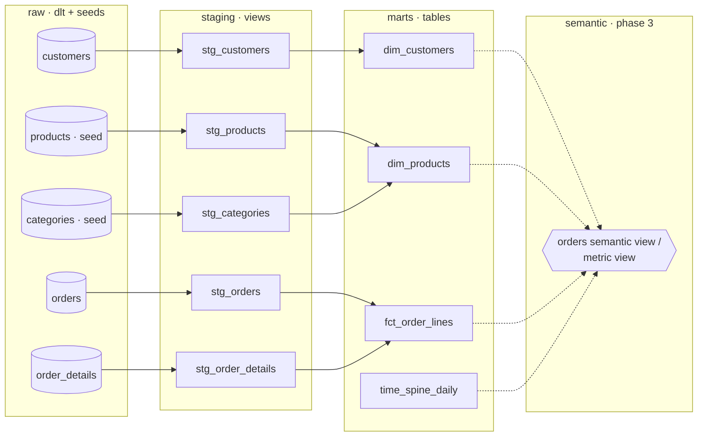
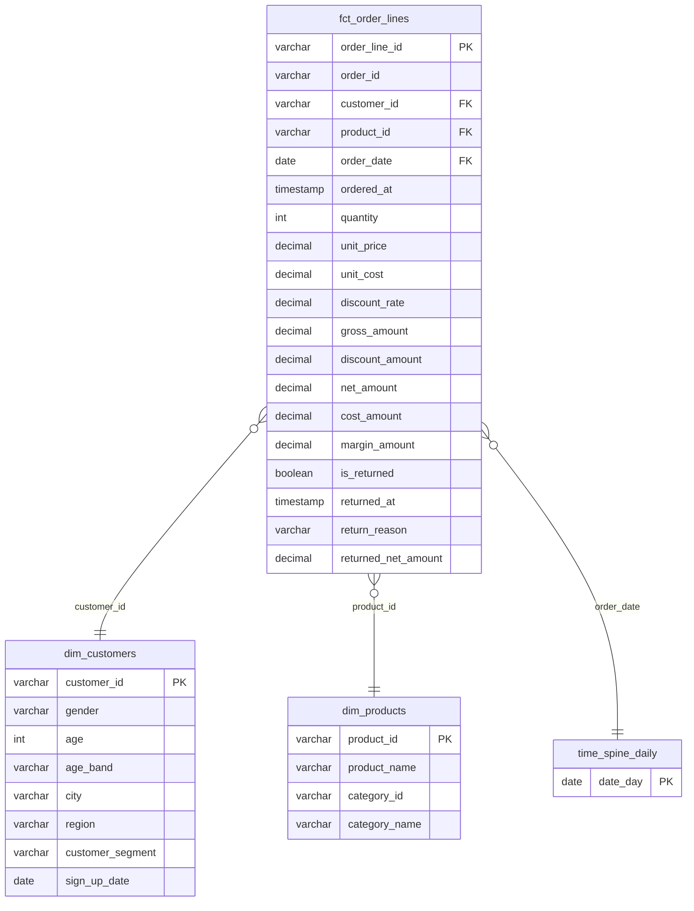

# Design 02: dbt models (and a sketch of the semantic layer)

Status: **revision 1, proposed**. Section A is a sketch of phase 3. Section B is the proposed phase 2, shaped by what the sketch turned up. Nothing is built yet.

Phases in this doc:

- **Phase 2 (proposed):** a dbt project on DuckDB covering seeds, sources, staging and marts, tested. The marts must also serve phase 3 and phase 4 without being reworked.
- **Phase 3 (sketch only):** one semantic definition, rendered as a Snowflake semantic view and a Databricks metric view.
- **Phase 4 (referenced only):** parity tests. They matter here because they define what "correct" means for the marts.

---

## A. Phase 3 sketch: the semantic layer

### A1. What each platform expects

These were checked against current docs and package source on 2026-11-12.

| | Snowflake semantic view | Databricks metric view |
|---|---|---|
| dbt support | `materialized='semantic_view'` from the `Snowflake-Labs/dbt_semantic_view` package | `materialized='metric_view'`, built into dbt-databricks since 1.12 |
| Model body | The SQL clauses `TABLES(...) RELATIONSHIPS(...) DIMENSIONS(...) METRICS(...)`, with tables referenced through `ref()` | **YAML** (`version: 1.1`, `source: ref(...)`, `joins`, `dimensions`, `measures`) |
| Joins | A `RELATIONSHIPS` entry from the fact's foreign key to the dimension's key. The dimension side **needs `PRIMARY KEY` declared** in `TABLES`, or Snowflake treats the relationship as many-to-many (in preview). | Star and snowflake joins are supported, but **joins must be many-to-one**. A many-to-many join silently takes the first matching row. |
| Time grains | Expressions on dimensions (`DATE_TRUNC`) | Expressions on dimensions (`DATE_TRUNC`). No built-in grain feature. |
| Query | `SEMANTIC_VIEW(sv METRICS ... DIMENSIONS ...)` | `MEASURE(m) ... GROUP BY` |

### A2. The single definition

The plan is dbt's own semantic YAML (`semantic_models` plus `metrics`). dbt parses and validates it, and it ends up in the dbt manifest. It's the standard dbt format, so it doesn't need a custom schema.

### A3. Where the generator lives (open, decided in phase 3)

| Option | How it works | For | Against |
|---|---|---|---|
| **A. Python, outside dbt** (the original plan) | `dbt parse` → Python reads `manifest.json` → writes model files to `models/generated/<platform>/`, committed → `dbt build` | Output is visible in git diffs. Easy to test with pytest. Good error messages when a definition can't be translated. | Two-step build. CI needs a check that generated files are up to date. |
| **B. dbt-native** | One model file per semantic view: `{{ config(materialized=...) }}{{ render_semantic('orders') }}`. The macro reads `graph.semantic_models` and `graph.metrics` and outputs SQL clauses or YAML depending on `target.type`. | dbt is the generator, so there's one tool and one build, with nothing generated to keep in sync. | Jinja is a weak language for writing a translator. `graph.semantic_models` exists in dbt-core 1.12.6 (checked in source) but isn't documented. Output is only visible in `target/compiled/`. |

**Why this matters now:** under option B the generator lives entirely inside the dbt project. That's why the project directory needs a name that covers the semantic layer too, not just transformation (B1).

### A4. What the sketch requires from phase 2

These are the requirements that would force rework if phase 2 ignored them.

| # | Requirement from phase 3 or 4 | Consequence for phase 2 |
|---|---|---|
| R1 | Both platforms want a **star schema** with many-to-one joins. | Marts are a star: one fact at order-line grain, plus dimension tables. **Categories are folded into `dim_products`**, so the joins stay a simple star rather than a snowflake. |
| R2 | Snowflake needs a **declared primary key** on each joined table. Databricks silently returns wrong numbers if a join isn't truly many-to-one. | Every mart has a **single-column key**, tested `unique` and `not_null`. Every foreign key on the fact is tested with `relationships`. |
| R3 | Metric expressions have to translate between two SQL dialects, and decimal arithmetic types differ between engines. | **Line amounts are computed once, in the fact table, cast to explicit decimal types.** Semantic-layer metrics then only use `SUM`, `COUNT` and `COUNT(DISTINCT)`, which are trivially portable. |
| R4 | Parity (phase 4) compares the semantic layer with **plain SQL on the marts**. | The marts are the reference implementation and must run identically on DuckDB, Snowflake and Databricks. |
| R5 | MetricFlow **requires a time spine** for time-based metrics. | Phase 2 builds `time_spine_daily`, which doubles as a date dimension. |
| R6 | Names in the semantic layer are what business users and Claude see. | Mart column names are the business names (`customer_segment`, `category_name`, `net_amount`), so the semantic layer doesn't need renames. |
| R7 | Timestamps differ by platform. Databricks `TIMESTAMP` carries a time zone. Snowflake's default is `TIMESTAMP_NTZ`. | One dispatched macro, `type_timestamp_ntz()`, used wherever a timestamp is built. |
| R8 | DuckDB has no semantic objects. | Semantic models are disabled on DuckDB. The marts and the plain-SQL parity baseline still run there. |

---

## B. Phase 2 proposal: the dbt project

### B1. Directory name (needs your decision)

`transform/` was rejected because, under option A3-B, the semantic layer would live in this directory too. A `dbt/` folder would shadow the installed `dbt` Python package. The options:

| Name | Notes |
|---|---|
| **`analytics/`** (recommended) | Names the job, covering models, tests and the semantic layer. It's a common convention for analytics-engineering repos. |
| `dbt_project/` | Says what it is, but `dbt_project/dbt_project.yml` repeats itself. |
| `warehouse/` | Fits the models but not the semantic layer. |

The rest of this doc uses `analytics/`.

### B2. Layout

```
analytics/
  dbt_project.yml          # project name: retail
  profiles.yml             # duckdb now; snowflake, databricks, admin later; creds via env_var()
  packages.yml             # dbt_utils only if a test needs it (none yet)
  macros/
    generate_schema_name.sql
    type_timestamp_ntz.sql # dispatched per adapter (R7)
  seeds/                   # products.csv, categories.csv (moved from repo root)
    _seeds.yml
  models/
    staging/
      _sources.yml
      _staging.yml
      stg_customers.sql  stg_orders.sql  stg_order_details.sql
      stg_products.sql   stg_categories.sql
    marts/
      _marts.yml
      dim_customers.sql  dim_products.sql  fct_order_lines.sql
      time_spine_daily.sql
    semantic/              # phase 3; empty for now
  tests/                   # singular tests (reconciliation)
```

dbt is run from the repo root with `DBT_PROJECT_DIR=analytics` and `DBT_PROFILES_DIR=analytics`, so the same commands work locally and in CI. dbt's packages are added to the existing `pyproject.toml`. `dbt-core`, `dbt-duckdb`, `dbt-snowflake` and `dbt-databricks` resolve together with dlt (core 1.12.6, capped by dbt-databricks 1.13.0).

### B3. Lineage



### B4. Staging rules

Each staging model has one source, no joins, and one job: produce clean, typed and correctly named columns.

| Rule | Applies to |
|---|---|
| Select columns explicitly and **drop `_dlt_load_id` and `_dlt_id`** | the three dlt tables |
| **Cast every column explicitly** to its final type, even ones that already have it, so types never depend on what the loader guessed | all |
| **Convert the return placeholders to NULL**: `9999-12-31` → NULL, `00:00:00` → NULL, `'None'` → NULL, but **only when `is_returned = 0`** | `stg_order_details` |
| **Combine date and time into a timestamp:** `ordered_at` and `returned_at`, using `type_timestamp_ntz()` | `stg_orders`, `stg_order_details` |
| Convert `is_returned` from 0/1 to a **boolean** | `stg_order_details` |
| Add a single-column key, **`order_line_id = order_id \|\| '-' \|\| product_id`** (R2). `\|\|` concatenation works on all three engines. | `stg_order_details` |
| Seeds are already UPPER_SNAKE. Staging selects them unquoted, so they come out the same as everything else. | `stg_products`, `stg_categories` |

### B5. Marts (star schema)



The fact table keeps order-level attributes on each line (`order_id`, `order_date`, `ordered_at`). Order counts then come from `COUNT(DISTINCT order_id)`, and no separate orders fact is needed for v1.

**Line amounts (R3).** Each amount is computed once and cast to an explicit type.

| Column | Formula | Type |
|---|---|---|
| `gross_amount` | `quantity * unit_price` | `decimal(18,2)` |
| `discount_amount` | `quantity * unit_price * discount_rate` | `decimal(18,6)` |
| `net_amount` | `gross_amount - discount_amount` | `decimal(18,6)` |
| `cost_amount` | `quantity * unit_cost` | `decimal(18,2)` |
| `margin_amount` | `net_amount - cost_amount` | `decimal(18,6)` |
| `returned_net_amount` | `net_amount` if returned, else `0` | `decimal(18,6)` |

### B6. Tests

| Kind | What |
|---|---|
| Keys (R2) | `unique` and `not_null` on every mart key. `relationships` from `fct_order_lines` to each dimension. |
| Placeholder handling | `returned_at` and `return_reason` are NULL exactly when `is_returned` is false. This is a singular test. |
| **Reconciliation** | The fact's `SUM(quantity)` and the sums behind `SUM(gross_amount)` and `SUM(cost_amount)` must equal the raw totals. The phase 1 checksums carry through the whole chain. This is a singular test. |
| Row counts | `fct_order_lines` has 30,271 rows. `dim_customers` has 1,000. `dim_products` has 100. |
| Accepted values | `gender`, `region`, `customer_segment`, `return_reason`. These also become dimension values in the semantic layer. |

### B7. Configuration

- **Schemas:** `generate_schema_name` uses a model's custom schema exactly as written, on every target, giving `raw`, `staging`, `marts` and `semantic`. The profile's own `schema` is only a fallback.
- **Materializations:** staging models are views, marts are tables, and semantic models (phase 3) use the platform materialization.
- **Seeds:** `+schema: raw`, `+quote_columns: false`, with explicit `column_types` for each seed.
- **Sources:** `raw` schema, no freshness checks (the data is static, D3). `loaded_at_field` can be added later from `_dlt_load_id` if loads become incremental.
- **DuckDB profile:** `path: "{{ env_var('DBT_DUCKDB_PATH', '.local/dev.duckdb') }}"`. The path is relative to the repo root, which is also where `load/pipeline.py` writes.

### B8. Decisions for review

| # | Decision | Proposal |
|---|---|---|
| E1 | Name of the dbt directory | `analytics/` (B1) |
| E2 | Shape of the marts | A star with one fact at line grain. Categories folded into `dim_products`. |
| E3 | Surrogate key | `order_id \|\| '-' \|\| product_id`. It's readable and portable. The alternative is a hash from `dbt_utils.generate_surrogate_key`. |
| E4 | Precision of the amounts | Exact (`decimal(18,6)`), with no rounding in the marts. Rounding happens only for display, so parity can be exact. The alternative is rounding to cents in the mart, which needs a single rounding rule all three engines agree on. |
| E5 | Packages | None for now. Built-in tests plus singular tests are enough. |
| E6 | Age band | Add `age_band` to `dim_customers` (18–24, 25–34, …), a useful dimension for the semantic layer. |

### B9. Proposed turns

1. **Skeleton:** `analytics/` with `dbt_project.yml`, `profiles.yml` and the two macros, plus the dbt packages in `pyproject.toml`. Move the seeds and run `dbt seed` and `dbt debug` on DuckDB.
2. **Sources and staging:** `_sources.yml` and the five staging models with their tests.
3. **Marts:** the three marts plus `time_spine_daily`, with their tests and the reconciliation tests.
4. **Close out phase 2:** update this doc as built. Then design 03 (semantic layer) turns section A into a full proposal.
