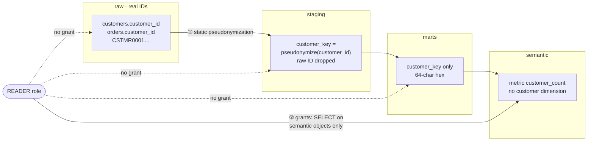
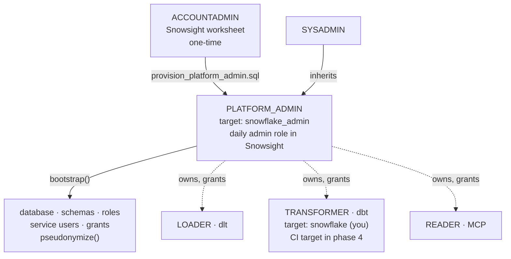
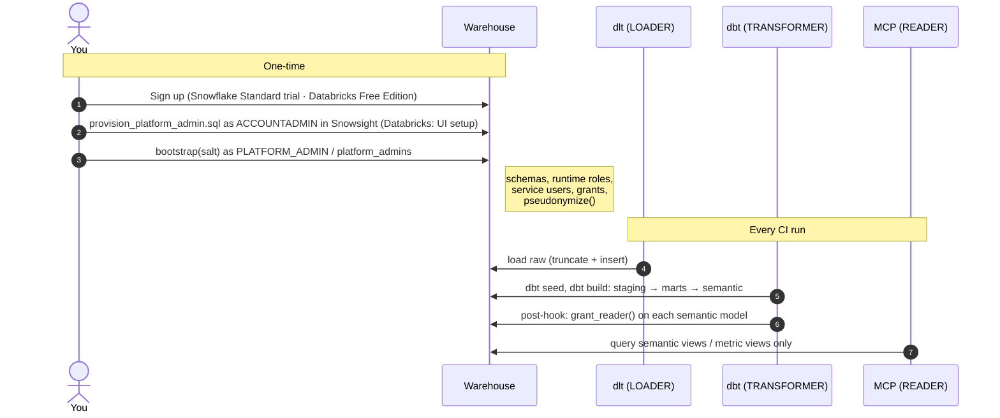

# Design 02A: Governance, RBAC and customer ID masking

Status: **revision 10**. G1–G10 are decided. Revision 4 added G9, where the name `governance` may live in the dbt project. Revision 5 added G10: `city` is dropped in staging. Revision 6 records the Snowflake account (2026-11-21), adds the cross-region inference setting to provisioning, and sets how people and dbt sign in (section 5). Revision 7 (2026-11-23) moves your own sign-in to the browser with MFA, so no secret is stored for your user. Because Snowflake blocks `ACCOUNTADMIN` from that sign-in, provisioning becomes a SQL script run in Snowsight instead of a dbt macro. Revision 8 (2026-11-23) records Snowflake provisioning as done, keeps the salt out of dbt's local files (section 4), lets `TRANSFORMER` create the seed tables in `raw` (section 6), and creates the function with `IF NOT EXISTS`. Revision 9 (2026-11-25) records Snowflake bootstrap as done and V5 as mostly resolved. Revision 10 has your local dlt loads sign in the same way, as `LOADER`. V1, V3 and V4 are resolved, V5 is deferred, and V2 has a cost-based fallback.

This is a child of design 02. It covers who can see what on each platform, how customer IDs are hidden, and the one-time admin setup.

## 1. Goal and threat model

**Goal:** a role that reads the semantic layer (the MCP reader) can **never see a raw customer ID**, through any path. Analysis still needs to work: counting distinct customers, and joining facts to customers.

**What we're protecting against:**
- A reader querying tables directly instead of the semantic layer.
- A reader reaching raw IDs through a view, a join, or a dimension exposed by mistake.
- Recovering raw IDs from hashed values. **This one matters here:** the IDs are `CSTMR0001` to `CSTMR1000`, so an unsalted hash can be reversed by hashing all 1,000 candidates. **The protection rests entirely on the salt staying secret.**

**Not in scope:** the data is synthetic, and gender, region and segment are low-risk attributes. Exact age (G7) and city (G10) are dropped in staging. Only the age band and region go downstream.

**Design principle:** no control depends on a paid feature tier or on a feature that may not exist on Databricks Free Edition (V1).

## 2. Two controls



| # | Control | What it guarantees | Where it lives in dbt |
|---|---|---|---|
| ① | **Static pseudonymization in staging.** `customer_key` is a salted SHA-256 hash of the ID. The raw `customer_id` is not selected. | Raw IDs **don't exist** in staging, marts or the semantic layer. The marts are built from staging, so the masking persists into them by construction. | The `pseudonymize()` macro, called in `stg_customers` and `stg_orders` |
| ② | **RBAC grants.** The reader gets `SELECT` on semantic views and metric views only. | The reader can't reach `raw`, `staging` or `marts`. Both platforms let a reader query a semantic or metric view without access to the tables underneath. | `grant_reader()` post-hook on semantic models, and `bootstrap` |

**Raw IDs therefore exist only in `raw`, which only LOADER and TRANSFORMER can read.** That's the full exposure.

**Why ① and not query-time masks on the marts:** a mask is evaluated for the **querying** role, even through a view. Masking `customer_key` for the reader would also mask it inside the reader's semantic-view queries. All customers would collapse into one masked value, and `customer_count` would always be 1.

**The semantic layer** exposes `customer_count` (`COUNT(DISTINCT customer_key)`) and customer attributes (segment, region, age band). It does **not** expose `customer_key` as a dimension (G4).

### Dropped: dynamic masking on raw (G8)

Revision 1 added a third control: masking policies on the raw ID columns as defense in depth. It's now dropped:

- **Snowflake:** masking policies need Enterprise Edition. That costs more per credit and might not stay affordable after the trial. Per V1, the design doesn't depend on it.
- **Databricks:** column masks aren't tied to a paid tier there. But masking only one platform would make the two governance setups differ for little gain, and it depends on V2.
- **What's lost:** protection only if someone grants `raw` to a reader by mistake. The phase 4 access check covers that case: it fails CI if the reader can query `raw` (section 8).
- **Reversible:** this could be added later on Databricks alone, as an `on-run-start` hook, without changing any models.

## 3. Pseudonymization (control ①)

```sql
-- stg_customers.sql (sketch)
select
    {{ pseudonymize('customer_id') }} as customer_key,
    ...
from {{ source('raw', 'customers') }}
```

The same macro runs in `stg_orders`, so the keys in the fact table and the customer dimension match, and joins work.

| Target | What `pseudonymize(col)` compiles to | Where the salt lives |
|---|---|---|
| DuckDB | `sha256('<dev salt>' \|\| ':' \|\| col)` | The `PII_SALT` environment variable, with a fixed fallback for development. Local only, synthetic data. |
| Snowflake | `governance.pseudonymize(col)` | Inside a **secure SQL UDF** created at bootstrap. Its definition is hidden from roles that don't own it. |
| Databricks | `governance.pseudonymize(col)` | Inside a **Unity Catalog SQL function** created at bootstrap. Only `transformers` get `EXECUTE` (V3). |

On every platform the function computes `sha2(salt || ':' || customer_id, 256)` and returns a 64-character hex string. With the same salt, all three platforms give identical keys.

## 4. Where the salt lives

dbt allows secret environment variables only in `profiles.yml` and `packages.yml`, **not in model SQL**. A salt passed in through a normal `env_var()` would appear in compiled SQL under `target/`, in dbt logs and in the warehouse's query history. So **the salt never appears in model SQL.** Models call a function, and the function holds the salt.

- **Setting it:** the salt is passed once, at bootstrap: `dbt --log-level-file none run-operation bootstrap --no-write-json --target <platform>_admin --args "{salt: $SALT}"`, with `SALT` read into an unexported shell variable. It appears in that one admin query in query history, which only admins can see.
- **Not in dbt's local files (revision 8).** *Checked:* by default dbt writes `--args` and the macro's SQL to `logs/dbt.log`, and the args to `target/run_results.json`, in plain text. `bootstrap()` refuses to run unless file logging is off and JSON output is disabled, and its own log lines show the salt as `<redacted>`.
- **No silent rotation.** The function is created with `IF NOT EXISTS`, so rerunning bootstrap with a mistyped salt can't change every customer key. Rotating the salt means dropping the function on purpose, then rebuilding.
- **Databricks (V3, resolved):** the salt is written into the function's definition. Databricks has a password-vault feature ("secret scopes") that SQL can read, which would keep the salt out of the function body, but it's an extra mechanism with uncertain Free Edition support. Not used. Limiting `EXECUTE` on the function to `transformers` keeps its body away from readers.
- **Rotating it:** replace the function and rebuild. Every key changes together, and nothing stores keys between builds, so nothing breaks.

## 5. Admin model: a scoped platform-admin role (G6)

**Principle:** whoever does admin work, in Snowsight or through dbt, should spend as little time as possible in high-trust roles. `ACCOUNTADMIN` is used **once**, for one script, and a scoped role does everything after that.

### Snowflake: three levels of trust



**`admin/snowflake/provision_platform_admin.sql`**, run once as `ACCOUNTADMIN` in a Snowsight worksheet. It does only what genuinely needs `ACCOUNTADMIN`:

| Step | Why it needs ACCOUNTADMIN |
|---|---|
| `CREATE ROLE PLATFORM_ADMIN`, granted to `SYSADMIN` (the standard hierarchy) and to your user | A starting point for the role tree |
| Grant `PLATFORM_ADMIN` these account privileges: `CREATE DATABASE`, `CREATE ROLE`, `CREATE USER` | Only an account-level role can grant account-level privileges |
| Create the warehouse (X-Small, `AUTO_SUSPEND = 60`) and a **resource monitor** that caps monthly credits, then hand the warehouse's ownership to `PLATFORM_ADMIN` | Only `ACCOUNTADMIN` can create resource monitors and attach them to a warehouse. Doing it here means `PLATFORM_ADMIN` never needs `CREATE WAREHOUSE`. |
| `ALTER ACCOUNT SET CORTEX_ENABLED_CROSS_REGION = 'AWS_US'` | The account is in AWS `ca-central-1`, where Cortex Analyst isn't hosted natively ([docs](https://docs.snowflake.com/en/user-guide/snowflake-cortex/cortex-analyst)). Cross-region inference lets it run there. Data stays stored in Canada; only each request's payload is processed in a US region, briefly. Account parameters are `ACCOUNTADMIN`-only, and `PLATFORM_ADMIN` deliberately can't set them. |

**Why a script, not a dbt macro.** dbt signs you in through the browser (below), and Snowflake blocks `ACCOUNTADMIN` as the primary role of that sign-in. Unblocking it takes an account-wide setting or a Support request, which would widen the high-trust surface to save one paste. You read the script before running it, which replaces the macro's dry run. Every statement is idempotent (`IF NOT EXISTS`, or a re-applied grant or setting), so a rerun is safe.

**The resource monitor caps warehouse compute only.** Cortex Analyst and other serverless features bill separately and aren't stopped by it. They're watched through the trial's credit balance.

**What `PLATFORM_ADMIN` deliberately does not get:** `MANAGE GRANTS` (which would allow granting anything on any object), integrations, shares, account parameters, billing and usage views, network policies, or any `APPLY ... POLICY` privilege. It can grant privileges on objects it **owns**, which is everything `bootstrap()` creates, and that's all it needs.

**`bootstrap()`**, run as `PLATFORM_ADMIN` through the `snowflake_admin` target. It's idempotent, so safe to rerun:

- **Objects:** the database, and the schemas `raw`, `staging`, `marts`, `semantic` and `governance`.
- **Roles:** `LOADER`, `TRANSFORMER` and `READER`, each granted to `PLATFORM_ADMIN` so the hierarchy stays intact.
- **Users:** `SVC_PIPELINE` and `SVC_MCP`, created as `TYPE = SERVICE` with RSA public keys.
- **The pseudonymize function:** `governance.pseudonymize()` as a secure UDF, with `USAGE` granted to `TRANSFORMER`.
- **Service users** are created only when their public key is passed, so bootstrap can run before every key exists.

**Snowflake provisioning: done 2026-11-23.** The script ran without errors. `SNOWFLAKE$LOCAL_APPLICATION` exists, and `PLATFORM_ADMIN`'s grants hold no `MANAGE GRANTS`.

**Snowflake bootstrap: done 2026-11-25,** without service users. Every statement ran as `PLATFORM_ADMIN`, including future grants and granting the roles it created. The service users are added by a rerun with their public keys (step 3d for `SVC_MCP`, phase 4 for `SVC_PIPELINE`).
- **Grants and future grants:** as in section 6.

**How people and dbt sign in (Snowflake):**
- **You, in Snowsight:** password plus MFA, enrolled in Snowsight. `ACCOUNTADMIN` work happens only here.
- **You, through dbt and dlt** (`snowflake_admin` as `PLATFORM_ADMIN`, `snowflake` as `TRANSFORMER`, and `load/pipeline.py snowflake` as `LOADER`, using the same environment variables): browser sign-in through Snowflake's built-in OAuth for local applications (`authenticator: oauth_authorization_code`, the `SNOWFLAKE$LOCAL_APPLICATION` integration). dbt opens Snowflake's sign-in page, where your password and MFA apply, and the connector caches the tokens in the macOS keychain. No key, password or client secret is stored for your user. ([docs](https://docs.snowflake.com/en/user-guide/oauth-local-applications))
- **Not used:** `externalbrowser` needs single sign-on through an identity provider (SAML), which this account doesn't have. `username_password_mfa` would put your password in an environment variable.
- **Blocked by Snowflake:** `ACCOUNTADMIN`, `SECURITYADMIN` and `ORGADMIN` can't be the primary role of an OAuth sign-in. We keep that default.
- **Service users** (`SVC_PIPELINE`, `SVC_MCP`): key pairs only. They run without a person present, so they can't use a browser, and `TYPE = SERVICE` can't use a password.

**After provisioning,** your day-to-day role in Snowsight is `PLATFORM_ADMIN`. You only switch to `ACCOUNTADMIN` to rerun provisioning or for billing.

**Confirmed:** `PLATFORM_ADMIN` holds every privilege dbt and bootstrap need, but **CI doesn't run as it.** CI runs as `TRANSFORMER` and `LOADER`, which have narrower runtime privileges. That way a leaked CI key can't create users or roles.

### Databricks: no role switching

Databricks has no equivalent of Snowflake's `USE ROLE`. Privileges belong to the identity (a user, a group, or a "service principal", which is Databricks' word for a non-human account, the equivalent of a Snowflake service user). On Free Edition you are automatically a full workspace admin, and that can't be scaled down. The equivalent of `PLATFORM_ADMIN` is therefore **a separate, scoped identity** that runs bootstrap:

| Identity | Privileges | Used for |
|---|---|---|
| You (workspace admin) | Everything | One-time setup in the UI: create the groups and principals below. The `databricks_provision` target is the same idea as Snowflake's provision step. |
| `platform_admins` group, holding an admin service principal | On the workspace catalog only: `USE CATALOG`, `CREATE SCHEMA`, `CREATE FUNCTION`, ownership of the schemas it creates | `bootstrap()` through the `databricks_admin` target |
| `loaders`, `transformers`, `semantic_readers` | Section 6 | Runtime |

Whether service principals exist on Free Edition is V2. If they don't, bootstrap runs as your user and the scoping applies only to the runtime identities.

## 6. Runtime roles and grants

### Snowflake

| Role | Used by | Privileges (granted by `PLATFORM_ADMIN`) |
|---|---|---|
| `LOADER` | dlt | `USAGE` on the warehouse and database. `USAGE` and `CREATE TABLE` on `raw`. Owns the raw tables. |
| `TRANSFORMER` | dbt (CI, target `snowflake`) | `SELECT` on `raw`, plus future grants. `CREATE TABLE` on `raw` for the dbt seeds (`products`, `categories`), which it then owns (revision 8). `USAGE` and `CREATE TABLE` / `VIEW` / `SEMANTIC VIEW` on `staging`, `marts` and `semantic`. `USAGE` on `governance.pseudonymize()`. |
| `READER` | MCP server | `USAGE` on the warehouse, the database and `semantic`. **`SELECT` on semantic views only**, granted per view by the `grant_reader()` post-hook. |

| User | Auth | Default role | Also granted |
|---|---|---|---|
| `SVC_PIPELINE` | Key pair | `TRANSFORMER` | `LOADER` |
| `SVC_MCP` | Key pair | `READER` | none |

### Databricks (Free Edition)

| Group | Members | Privileges (workspace catalog) |
|---|---|---|
| `loaders` | CI principal | `USE CATALOG`. `USE SCHEMA` and `CREATE TABLE` on `raw`. |
| `transformers` | CI principal | `USE CATALOG`. `SELECT` on `raw`. All privileges on `staging`, `marts` and `semantic`. `EXECUTE` on `governance.pseudonymize`. |
| `semantic_readers` | MCP principal | `USE CATALOG`. `USE SCHEMA` on `semantic`. **`SELECT` on metric views only.** |

### Schemas (both platforms)

`raw`, `staging`, `marts`, `semantic` and `governance`.

## 7. Setup and run order



**Admin checklist** (it goes into a README when the accounts exist):

1. **Snowflake:** start the trial at the start of phase 3, since the 30-day clock starts at signup. **Standard Edition is enough** (V1). Generate RSA key pairs for `SVC_PIPELINE` and `SVC_MCP`.
2. **Databricks:** sign up for Free Edition. Create a personal access token for setup. Create the groups and principals in the workspace admin settings (V2).
3. **Salt:** generate it once (`openssl rand -hex 32`) and store it in your password manager.
4. **Provision, then bootstrap,** once per platform.
5. **CI secrets:** the `SVC_PIPELINE` key and the Databricks CI token. The MCP credentials stay local.

## 8. Verification

| Check | How | When |
|---|---|---|
| No raw IDs after staging | A dbt singular test fails if any `customer_key` in staging or marts matches `CSTMR%`, or isn't 64 hex characters | Phase 2, on DuckDB |
| Joins survive hashing | `relationships` from `fct_order_lines.customer_key` to `dim_customers` | Phase 2 |
| No hash collisions | `COUNT(DISTINCT customer_key)` in marts = `COUNT(DISTINCT customer_id)` in raw = 1,000 | Phase 2 |
| **Reader can't reach tables** | A Python check connects as `READER` / `semantic_readers`. `SELECT` on `raw`, `staging` and `marts` must fail, and a semantic query must succeed. This replaces the dropped raw masks as the guard against a mistaken grant. | Phase 4, CI |
| PLATFORM_ADMIN is scoped | `SHOW GRANTS TO ROLE PLATFORM_ADMIN` contains no `MANAGE GRANTS` and no `ACCOUNTADMIN` | Phase 3, once |

## 9. Decisions

| # | Decision | Outcome |
|---|---|---|
| G1 | Primary control | **Static pseudonymization in staging** |
| G2 | What a masked value looks like | **The pseudonym**, never `***`. With the dynamic masks dropped (G8), this means `customer_key` is the only form of a customer ID anywhere past `raw`. |
| G3 | Salt location | **Inside a warehouse function**, created at bootstrap. DuckDB uses an environment variable. |
| G4 | Semantic exposure | **`customer_count` only.** No customer key dimension. |
| G5 | How raw masks are applied | ~~An `on-run-start` hook~~. **Superseded by G8**, because there are no raw masks to apply. |
| G6 | Admin role | **Scoped `PLATFORM_ADMIN`**, provisioned once by `ACCOUNTADMIN` through a script run in Snowsight (section 5; a dbt macro until revision 7) |
| G7 | Exact age | **Dropped in staging.** Only `age_band` goes downstream. |
| **G8** | **Dynamic masking on raw** | **Dropped on both platforms.** Raw is protected by grants, and the phase 4 access check enforces that. This supersedes G5. |
| **G9** | **Where the name `governance` lives in the dbt project** | **Either `macros/governance/` or `models/governance/`, never both.** It's the macros folder today. If governance-owned models are ever needed, the governance folder moves or is renamed so the name still points to one place in the project. The warehouse schema `governance`, which holds the pseudonymize function, deliberately shares the name with whichever folder it is. |
| **G10** | **City** | **Dropped in staging.** It's too precise, and next to gender, age band and segment it can narrow a group to a handful of people (the smallest of the 10 cities has 9 customers). `region` (5 values) is the only location attribute downstream. |

## 10. To verify when the accounts exist

| # | What, in plain terms | Fallback |
|---|---|---|
| ~~V1~~ | ~~Trial accepts Enterprise~~ | **Resolved:** no design dependency on Enterprise |
| V2 | **Does Databricks Free Edition let us create (a) groups and (b) service principals?** We need them so that CI, MCP and bootstrap each get their own limited identity, instead of everything running as your all-powerful admin user. The Free Edition docs don't say. | Without groups, grant privileges to the identities directly. Without service principals, CI and bootstrap run with your token, and MCP uses a second invited user if allowed. Otherwise MCP also uses your token, and the reader restriction can't be demonstrated on Databricks. **Preferred fallback:** if Free Edition lacks these, use a paid Databricks workspace (trial or pay-as-you-go). Cost guidance: acceptable if setup plus minimal running stays under about $50 CAD. If ongoing upkeep is too high, capture screenshots and recordings of the working system, then decommission it. It must be shown working live at least once. |
| ~~V3~~ | ~~`secret()` inside a function~~ | **Resolved:** the salt goes in the function body, with `EXECUTE` limited to `transformers` |
| ~~V4~~ | ~~Masks through semantic views~~ | **Resolved, it doesn't matter:** everything the semantic layer touches is already pseudonymous (control ①) |
| V5 *(mostly resolved 2026-11-25: future grants and role grants work; `CREATE USER ... TYPE = SERVICE` is checked at the first rerun with a key)* | Snowflake: can `PLATFORM_ADMIN` do everything `bootstrap()` needs without `MANAGE GRANTS`? This includes future grants in schemas it owns, granting roles it created, and `CREATE USER ... TYPE = SERVICE`. | Add the specific missing privilege to `provision_platform_admin.sql`, never `MANAGE GRANTS` as a blanket fix |
