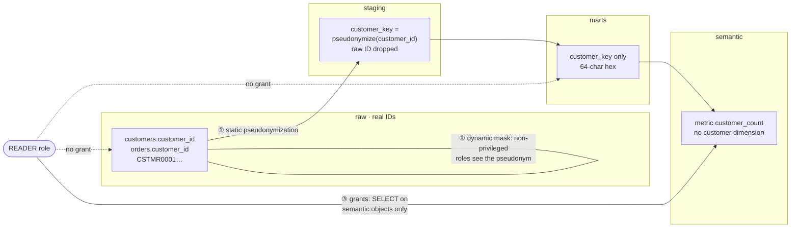
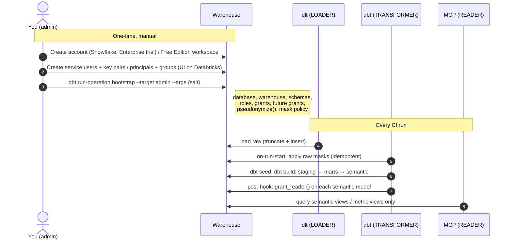

# Design 02A: Governance, RBAC and customer ID masking

Status: **revision 1, proposed**. This is a child of design 02. It covers who can see what on each platform, how customer IDs are hidden, and the one-time admin setup. Design 02 refers to it wherever staging, marts or configuration are affected.

## 1. Goal and threat model

**Goal:** a role that reads the semantic layer (the MCP reader) can **never see a raw customer ID**, through any path. Analysis still needs to work: counting distinct customers, and joining facts to customers.

**What we're protecting against:**
- A reader querying tables directly instead of the semantic layer.
- A reader reaching raw IDs through a view, a join, or a dimension exposed by mistake.
- Recovering raw IDs from hashed values. **This one matters here:** the IDs are `CSTMR0001` to `CSTMR1000`, so an unsalted hash can be reversed by hashing all 1,000 candidates. **The protection rests entirely on the salt staying secret.**

**Not in scope:** the data is synthetic, and gender, city, region and segment are low-risk attributes. Exact age is handled by banding (design 02, E6).

## 2. Three layers of control



| # | Control | What it guarantees | Where it lives in dbt |
|---|---|---|---|
| ① | **Static pseudonymization in staging.** `customer_key` is a salted SHA-256 hash of the ID. The raw `customer_id` is dropped in the same staging model. | Raw IDs **don't exist** in staging, marts or the semantic layer. **This is how the masking persists into the marts:** the marts are built from staging, and staging never outputs the raw value. | The `pseudonymize()` macro, called in `stg_customers` and `stg_orders` |
| ② | **A dynamic mask on the raw columns.** Any role other than loader or transformer sees the pseudonym instead of the raw ID. | Defense in depth. If `raw` were ever granted by mistake, it would still show no raw IDs. The masked value equals `customer_key`, so it still joins. | Policy macros, applied by an `on-run-start` hook (section 5) |
| ③ | **RBAC grants.** The reader gets `SELECT` on semantic views and metric views only. | The reader can't reach `raw`, `staging` or `marts` at all. Both platforms let a reader query a semantic or metric view without access to the tables underneath. | `grant_reader()` post-hook on semantic models, and bootstrap |

**Why ① and not a mask on the marts:** a mask uses the **querying** role, even when the query goes through a view (Snowflake evaluates table policies with `CURRENT_ROLE`). Masking `customer_key` in the marts for the reader would therefore also mask it inside the reader's semantic-view queries. Every customer would collapse into one masked value, and `customer_count` would always come out as 1. Pseudonymizing at build time avoids that: the marts hold only pseudonyms, so there is nothing left to mask downstream.

**The semantic layer** exposes `customer_count` (`COUNT(DISTINCT customer_key)`) and customer attributes (segment, region, age band). It does **not** expose `customer_key` as a dimension.

## 3. Pseudonymization (control ①)

```sql
-- stg_customers.sql (sketch)
select
    {{ pseudonymize('customer_id') }} as customer_key,
    ...
from {{ source('raw', 'customers') }}
```

The same macro runs in `stg_orders`, so the keys in the fact table and the customer dimension match, and joins work.

**The macro calls each platform's own implementation:**

| Target | What `pseudonymize(col)` compiles to | Where the salt lives |
|---|---|---|
| DuckDB | `sha256('<dev salt>' \|\| ':' \|\| col)` | The `PII_SALT` environment variable, with a fixed fallback for development. Local only, synthetic data. |
| Snowflake | `governance.pseudonymize(col)` | Inside a **secure SQL UDF** created at bootstrap. A secure UDF hides its definition from roles that don't own it. |
| Databricks | `governance.pseudonymize(col)` | Inside a **Unity Catalog SQL function** created at bootstrap. Only transformers get `EXECUTE` on it. |

On every platform the function computes `sha2(salt || ':' || customer_id, 256)` and returns a 64-character hex string. With the same salt, all three platforms give identical keys. Metric parity doesn't need this, but it's a free extra check.

## 4. Where the salt lives

dbt allows secret environment variables (`DBT_ENV_SECRET_*`) only in `profiles.yml` and `packages.yml`, **not in model SQL**. A salt injected through a normal `env_var()` would appear in compiled SQL under `target/`, in dbt logs and in the warehouse's query history. So on the warehouse platforms **the salt never appears in model SQL.** Models call a function, and the function holds the salt.

- **Setting it:** the salt is passed once, at bootstrap, by an admin: `dbt run-operation bootstrap --args '{salt: ...}'` on the `admin` target, with the value taken from a local environment variable. It appears in that one admin query in query history, which only admins can see.
- **Rotating it:** create a new function version and rebuild. Every key changes together, and nothing stores keys between builds, so nothing breaks.
- **Option for Databricks:** Databricks SQL has a `secret(scope, key)` function, which would keep even the function body free of the salt. It's unclear whether it can be called inside a UC function body. Try it at setup; if it fails, embed the salt in the function body (V3).

## 5. Dynamic mask on raw (control ②)

The raw tables are created by dlt, not dbt, so dbt **post-hooks can't reach them.** The policies are still kept in dbt as macros, and an idempotent **`on-run-start`** hook applies them at the start of every `dbt build`. That's the closest dbt equivalent of a post-hook for tables dbt doesn't build.

| | Snowflake | Databricks |
|---|---|---|
| Policy object | `MASKING POLICY governance.mask_customer_id` | SQL function `governance.mask_customer_id` |
| Logic | `CASE WHEN IS_ROLE_IN_SESSION('LOADER') OR IS_ROLE_IN_SESSION('TRANSFORMER') THEN val ELSE governance.pseudonymize(val) END` | `CASE WHEN is_member('transformers') OR is_member('loaders') THEN v ELSE governance.pseudonymize(v) END` |
| Applying it | `ALTER TABLE raw.customers MODIFY COLUMN customer_id SET MASKING POLICY ... FORCE` | `ALTER TABLE raw.customers ALTER COLUMN customer_id SET MASK ...` |
| Created by | `bootstrap` (admin) | `bootstrap` (admin) |
| Applied by | `on-run-start`, as TRANSFORMER. Needs the account-level `APPLY MASKING POLICY` privilege, because LOADER owns the raw tables. | `on-run-start`. Needs ownership of the table, so the CI principal that loads also applies (V2). |
| Edition or feature | **Needs Snowflake Enterprise Edition** (V1) | Column masks work on tables only, not on views |

**Applies to:** `raw.customers.customer_id` and `raw.orders.customer_id`.

dlt's `replace` mode truncates and reinserts by default, which keeps the table and its mask. The hook re-applies the masks on every run anyway, in case a table is ever dropped and recreated.

**For models dbt builds:** dbt-databricks also supports masks as a column config (`column_mask: {function: ...}`, since v1.10.4). Under control ①, no dbt-built model contains raw IDs, so nothing in dbt needs it now.

## 6. Roles and grants

### Snowflake

| Role | Used by | Privileges |
|---|---|---|
| `ACCOUNTADMIN` | **The `admin` target, for bootstrap only** | Creates everything below. Never used by CI or the MCP server. |
| `LOADER` | dlt | `USAGE` on the warehouse and database. `USAGE` and `CREATE TABLE` on `raw`, and ownership of the raw tables. |
| `TRANSFORMER` | dbt | `SELECT` on `raw`. Ownership of `staging`, `marts` and `semantic`. `USAGE` on the `governance` functions. Account-level `APPLY MASKING POLICY`. |
| `READER` | MCP server | `USAGE` on the warehouse and database. `USAGE` on `semantic`. **`SELECT` on semantic views only**, plus future grants. |

| User | Auth | Roles |
|---|---|---|
| `SVC_PIPELINE` | Key pair | `LOADER`, `TRANSFORMER` |
| `SVC_MCP` | Key pair | `READER` |

### Databricks (Free Edition)

| Group | Members | Privileges (in the workspace catalog) |
|---|---|---|
| `loaders` | CI principal | `USE CATALOG`. `USE SCHEMA` and `CREATE TABLE` on `raw`. |
| `transformers` | CI principal | `USE CATALOG`. `SELECT` on `raw`. All privileges on `staging`, `marts` and `semantic`. `EXECUTE` on the `governance` functions. |
| `semantic_readers` | MCP principal | `USE CATALOG`. `USE SCHEMA` on `semantic`. **`SELECT` on metric views only.** |

Free Edition has no account console. That means only workspace-local groups (hence `is_member()` rather than `is_account_group_member()`), and service principals may or may not be available (V2). If they aren't, the fallback is your own user for CI plus a second user for MCP.

### Schemas (both platforms)

`raw`, `staging`, `marts`, `semantic`, and a new **`governance`** schema for the pseudonymize function and the masking policy. Design 02's `generate_schema_name` handles `governance` like the rest.

## 7. Admin setup and run order



**Admin checklist** (it goes into a README when the accounts exist):

1. **Snowflake:** start the trial as **Enterprise Edition** at the start of phase 3, since the 30-day clock starts at signup. Create `SVC_PIPELINE` and `SVC_MCP` with RSA key pairs.
2. **Databricks:** sign up for Free Edition. Create a personal access token for admin work. Create the three groups and the principals in the workspace admin settings.
3. **Salt:** generate it once (`openssl rand -hex 32`). Store it in your password manager and as a GitHub Actions secret, which is only needed if bootstrap ever runs in CI.
4. **Bootstrap:** run `dbt run-operation bootstrap --target admin` once per platform. It's idempotent, so safe to rerun.
5. **CI secrets:** the `SVC_PIPELINE` key and the Databricks CI token. The MCP credentials stay local and are never used in CI.

## 8. Verification

| Check | How | When |
|---|---|---|
| No raw IDs after staging | A dbt singular test fails if any `customer_key` in staging or marts matches `CSTMR%`, or isn't 64 hex characters | Phase 2, on DuckDB |
| Joins survive hashing | `relationships` from `fct_order_lines.customer_key` to `dim_customers` | Phase 2 |
| Same customer count before and after hashing | `COUNT(DISTINCT customer_key)` in marts equals `COUNT(DISTINCT customer_id)` in raw (1,000), so no hash collisions | Phase 2 |
| The reader can't reach tables | A Python check connects as `READER` / `semantic_readers`. `SELECT` on `raw`, `staging` and `marts` must fail, and a semantic query must succeed. | Phase 4, CI |
| The raw mask works | As a non-privileged role, `raw.customers.customer_id` must return pseudonyms, not `CSTMR…` | Phase 4, CI |

## 9. Decisions for review

| # | Decision | Proposal |
|---|---|---|
| G1 | Primary control | **Static pseudonymization in staging** (①). Dynamic masking only on `raw` (②). |
| G2 | Masked value | **The pseudonym**, not `'***'`, so masked raw values still join to the marts. |
| G3 | Salt location | Inside a warehouse function, created at bootstrap. DuckDB uses an environment variable. |
| G4 | Semantic exposure | `customer_count` only. **No customer key dimension.** |
| G5 | How raw masks are applied | An `on-run-start` hook, because raw tables aren't dbt models, so post-hooks can't reach them |
| G6 | Bootstrap role on Snowflake | `ACCOUNTADMIN`, admin target only. Splitting it across `SYSADMIN`, `SECURITYADMIN` and `USERADMIN` is cleaner, but a dbt target can only use one role. |
| G7 | Exact age | Dropped in staging. Only `age_band` goes downstream (data minimization). |

## 10. To verify when the accounts exist

| # | What | Fallback |
|---|---|---|
| V1 | The Snowflake trial accepts Enterprise Edition | Without Enterprise there are no masking policies. Controls ① and ③ still hold. |
| V2 | Databricks Free Edition: service principals, workspace groups, and `ALTER TABLE ... SET MASK` on tables dlt created | Use user accounts instead of service principals. Load and apply masks with the same principal. |
| V3 | Databricks `secret()` inside a UC SQL function | Embed the salt in the function body, with `EXECUTE` limited to transformers |
| V4 | Masking policies on underlying tables apply as expected when a semantic view or metric view is queried (not documented on either platform) | Control ① makes this irrelevant for customer IDs. It only matters for control ②. |
