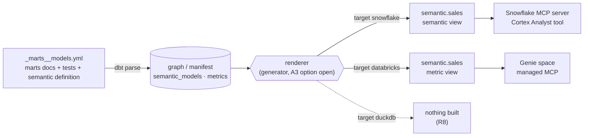
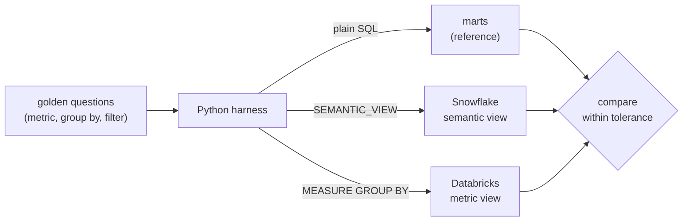
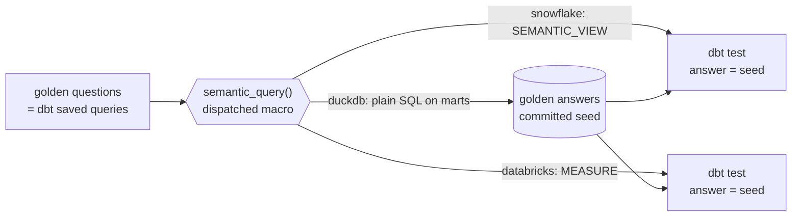
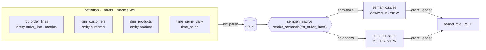

# Design 03: Semantic layer (and a sketch of parity tests)

Status: **revision 9. H1–H13 are decided** (approved 2026-11-17). D9 turns 1–2 are built. Section A revisits the phase 3 sketch from [design 02 §A](02-dbt-models.md) using findings checked on 2026-11-16. Section B sketches phase 4. Section C turns what the phase 4 sketch found into phase 3 requirements. Section D is the phase 3 design. Revisions 3–5 removed the sort columns and `city`, made `return_reason` a dimension, justified the ratio denominators and added a unit-based return rate. Revision 6 recorded approval: H13 stays "before returns" for v1, and H11 is approved as proposed. Revision 7 recorded turn 1 as built and added the column check it showed is needed (S3, turn 2). Revision 8 recorded turn 2 as built. Revision 9 drops the semantic model's `name: sales` override. The semantic model is now `fct_order_lines`, and `sales` names only the model that builds `semantic.sales`.

Phases in this doc:

- **Phase 3 (to be proposed):** one semantic definition in dbt, rendered as a Snowflake semantic view and a Databricks metric view. This covers phases 2 and 3 of the original plan.
- **Phase 4 (sketch only):** parity tests and CI.
- **Phase 5 (referenced only):** the MCP demo. It matters here because the semantic objects are what Claude will query.

---

## A. Phase 3 sketch, revisited

### A1. Findings since design 02

Each was checked against current docs, package source, or a local experiment on a scratch copy of `dbt_scope` (marked *tested*).

| # | Finding | Effect on the sketch |
|---|---|---|
| F1 | **dbt 1.12 supports the latest semantic YAML spec** ([docs](https://docs.getdbt.com/docs/build/latest-metrics-spec)). Semantic properties sit on the model's own YAML entry: `semantic_model:`, `agg_time_dimension:`, `entity:` and `dimension:` on columns, and `metrics:` with `agg` and `expr`. Measures no longer exist. *Tested:* it parses on dbt-core 1.12.6 with DuckDB. A model can be described in only one YAML file, so a separate `semantic/*.yml` describing the marts fails to parse. | The single definition lives **in `_marts__models.yml`**, next to the column descriptions and tests. The original plan's `models/semantic/*.yml` and its legacy `semantic_models:` / `measures:` syntax are superseded. |
| F2 | *Tested:* `graph.semantic_models`, `graph.metrics` and `graph.saved_queries` can be read from Jinja at run time. In `manifest.json`, a simple metric carries `expr` plus `metric_aggregation_params.agg`, and a ratio metric carries `numerator` and `denominator`. Dimensions without an `expr` map to their column. `meta` (for example synonyms) is preserved. | Both generator options from design 02 A3 can read everything they need. Option B no longer depends on an unverified assumption. |
| F3 | **`Snowflake-Labs/dbt_semantic_view` 1.0.6** passes the model body straight through to `CREATE SEMANTIC VIEW`. Tables are written `alias AS {{ ref(...) }}`. Its options are `copy_grants` and `create_or_alter`. It has no `grants` support, `persist_docs` doesn't apply, and it doesn't read dbt semantic models. ([README](https://github.com/Snowflake-Labs/dbt_semantic_view)) | Something must render the clause text. The package is only the materialization. |
| F4 | **Snowflake semantic views** ([CREATE SEMANTIC VIEW](https://docs.snowflake.com/en/sql-reference/sql/create-semantic-view)):<br>• Names are `table_alias.name`. A bare name works only if it's unique in the view.<br>• Metrics can refer to other metrics.<br>• `WITH SYNONYMS` and `COMMENT` are allowed on dimensions and metrics.<br>• Optional clauses: `AI_SQL_GENERATION`, `AI_VERIFIED_QUERIES`, `COPY GRANTS`.<br>• **`SELECT` on the semantic view alone is enough to query it**, with no grants on the underlying tables.<br>• Queried with `SEMANTIC_VIEW(...)` or with standard SQL using `AGG()`. | Confirms 02A's reader model. Name uniqueness becomes a parity concern (B3). |
| F5 | **dbt-databricks 1.13 `metric_view`** (*read in package source*) runs `CREATE OR REPLACE VIEW ... WITH METRICS LANGUAGE YAML AS $$...$$` and supports dbt's `grants:` config and `databricks_tags`.<br>• YAML 1.1 adds `synonyms`, up to 10 per field.<br>• Measures can refer to other measures with `MEASURE()`.<br>• Window measures are experimental.<br>• Querying needs Databricks Runtime 17.2 or later. ([YAML reference](https://docs.databricks.com/aws/en/metric-views/data-modeling/syntax)) | Ratio metrics translate naturally to `MEASURE(a) / MEASURE(b)`. |
| F6 | **`DATE_TRUNC` returns different types.** It returns `DATE` on Snowflake, but `TIMESTAMP` on DuckDB (*tested*) and Databricks (documented). | Every truncated grain needs an explicit `::DATE`, or the platforms return different types. |
| F7 | *Tested:* the installed MetricFlow 0.213 includes an `msi_to_osi` converter. | The optional OSI export (phase 5) is close to free. |
| F8 | **MCP.**<br>• Snowflake's managed MCP server (`CREATE MCP SERVER`) exposes a semantic view through a `CORTEX_ANALYST_MESSAGE` tool. It supports semantic views only, and a caller needs `USAGE` on the server plus `SELECT` on the view. ([docs](https://docs.snowflake.com/en/user-guide/snowflake-cortex/cortex-agents-mcp))<br>• Databricks' managed MCP serves Genie spaces, which can include metric views. It's in public preview, a workspace admin must enable it, and Free Edition support is unconfirmed. ([docs](https://docs.databricks.com/aws/en/generative-ai/mcp/managed-mcp)) | Phase 5 needs one extra Snowflake object (the MCP server) and grant. On Databricks, the MCP path depends on account setup (02A V2). |

### A2. The sketch now



The open question from design 02 A3 (Python generator outside dbt, or a dbt-native renderer) is still open. Section B is what should settle it.

---

## B. Phase 4 sketch: parity tests and CI

### B1. Goal

Prove that both platforms give the same answer to the same governed question. The original plan:
- A `golden_questions.yml` file.
- A Python harness that runs each question three ways: plain SQL on the marts, the Snowflake semantic view, and the Databricks metric view.
- Results compared within a rounding tolerance, in a CI job per platform.

### B2. First-pass flow



### B3. What sketching it turned up

Each of these is a problem the first-pass flow hits. Revision 2 turns them into phase 3 requirements.

| # | Problem | Why |
|---|---|---|
| P1 | **Names don't line up across platforms.** | Snowflake names are `alias.name` and return upper case. Databricks names are flat and return lower case. MetricFlow names are `entity__name`. A harness needs a mapping, and the mapping only works if bare names are unique. |
| P2 | **Time grains don't exist on either platform.** | MetricFlow has `order_date__month`, but semantic views and metric views only have dimensions. Grains have to be dimensions with the same names on both platforms, and the same types (F6). |
| P3 | **Ratios can't be compared exactly.** | Decimal division gives a different scale on each engine. Sums and counts of cents are exact everywhere, but ratios need a tolerance. |
| P4 | **NULL groups.** | `return_category` is NULL on non-returned lines. NULLs sort first on Databricks and last on Snowflake and DuckDB, and `NULL = NULL` isn't true in SQL. The comparison has to handle this explicitly. |
| P5 | **Both warehouses must be live in one job.** | A Python harness comparing Snowflake with Databricks directly needs both accounts up at once. The Snowflake trial expires after 30 days, and Free Edition stops compute when a quota is hit. |
| P6 | **Golden questions are unvalidated.** | A typo in a metric name in `golden_questions.yml` fails only at run time, on a warehouse. |
| P7 | **Verified queries need the golden questions inside the semantic view.** | Snowflake's `AI_VERIFIED_QUERIES` is a clause in the view's DDL. Whatever renders the view must be able to read the golden questions. |
| P8 | **Grants disappear on rebuild.** | The Snowflake package uses `CREATE OR REPLACE` by default, which drops grants unless `copy_grants` is set. |
| P9 | **DuckDB can't run the semantic queries.** | But the plain-SQL reference can run there, so it could be computed once, locally, with no accounts. |

### B4. Phase 5 touchpoints

- The **MCP reader** queries the semantic objects only (02A). Phase 5 adds a Snowflake MCP server object, plus `USAGE` on it for `READER`.
- **Synonyms and comments** in the semantic definition are what Cortex Analyst and Genie read. They need to reach both platforms (F4, F5).
- **Golden answers** double as an evaluation set: does Claude, through MCP, give the golden answer?

---

## C. What phase 4 requires from phase 3

### C1. Requirements

| # | From | Requirement for phase 3 |
|---|---|---|
| S1 | P1 | **Every dimension and metric name is unique and snake_case across the whole definition**, so a bare name means the same thing everywhere. Snowflake's logical-table alias is the entity name. One name then maps mechanically: MetricFlow `customer__region` → Snowflake `customer.region` → Databricks `region`. The renderer fails the build on a duplicate. |
| S2 | P2, F6 | **Time grains are generated as named dimensions**, identical on both platforms: `order_date`, `order_week`, `order_month`, `order_quarter`, `order_year`. Each is `DATE_TRUNC(...)::DATE`. Weeks start on Monday on all three engines (design 02, A4 note), and week-number functions are never used. |
| S3 | P3 | **Metric types are limited to v1's set:**<br>• Simple metrics (`sum`, `count`, `count_distinct`) whose `expr` is **one fact column**. Any logic becomes a mart column, as design 02 R3 already requires.<br>• Ratios of two simple metrics, rendered as `a / NULLIF(b, 0)`.<br>• **Every `expr` and dimension must be a column documented on its model.** dbt doesn't check this: *tested in turn 1*, a misspelled column in `expr` parses cleanly, while a misspelled metric reference fails. The renderer checks it.<br>• No `average`, no filtered metrics, no cumulative metrics. The renderer fails on anything else.<br>Parity compares sums and counts exactly and ratios within a tolerance. |
| S4 | P6, P7 | **Golden questions are dbt saved queries** (*tested*: they parse and appear in `graph.saved_queries`). dbt validates their metric names at parse time, and the renderer can read them. Filters are limited to a range on the order date and equality or `IN` on a dimension. |
| S5 | P4, P5, P9 | **Parity needs an answer set computed independently of both warehouses.** A dispatched `semantic_query()` macro renders a golden question as plain SQL on the marts (default), as `SEMANTIC_VIEW(...)` (Snowflake), or as `MEASURE() ... GROUP BY` (Databricks). Design 04 decides the rest. The renderer only has to make that macro possible, which S1–S4 do. |
| S6 | P8 | Reader grants survive rebuilds: `copy_grants=true` on Snowflake, plus the `grant_reader()` post-hook (02A) on both platforms. |
| S7 | B4 | Synonyms and descriptions are written once, in the definition, and rendered to both platforms (`WITH SYNONYMS`/`COMMENT` on Snowflake, `synonyms`/`comment` on Databricks). |

### C2. Where this points parity (input to design 04, not decided here)



The answers are computed once on DuckDB and committed as a seed. Each platform then proves *its own* semantic layer matches the seed in an ordinary dbt test. This solves several sketch problems:
- **P5:** platforms are tested independently, so the two warehouses never need to be up in the same job.
- **P4:** the comparison is SQL inside the warehouse, so identifier case doesn't matter and NULLs are handled once, in the test.
- **Evidence:** the seed is readable in git ("net revenue in Marmara in 2025 was …").
- **Phase 5:** the same seed is the answer key for the MCP evaluation.

The same macro can also run the plain-SQL version on each platform's marts. That tells a mart difference apart from a semantic-layer difference.

---

## D. Phase 3 proposal

### D1. How it fits together



### D2. Layout additions

```
dbt_scope/
  packages.yml               # Snowflake-Labs/dbt_semantic_view, pinned (H7)
  dbt_project.yml            # + semantic folder: schema, materialization by target, enabled on SF/DB only
  macros/
    semgen/                  # the renderer (H2); not named "semantic", see note
      render_semantic.sql    # entry point; snowflake__ and databricks__ implementations
      semantic_catalog.sql   # reads graph, applies S1–S3 checks, builds the name map
    governance/              # + snowflake__ and databricks__ versions (02A)
  models/
    marts/_marts__models.yml # + the semantic definition (F1)
    semantic/
      sales.sql              # refs the star + {{ render_semantic('fct_order_lines') }}
```

- **Folder names:** the macro folder is `semgen/`, not `semantic/`, so no name lives in both `macros/` and `models/`. This follows the spirit of 02A G9.
- **Configuration:** `models/semantic/` gets folder-level config in `dbt_project.yml`, as staging and marts do:
  - `+schema: semantic`
  - `+enabled: "{{ target.type in ['snowflake', 'databricks'] }}"` (R8)
  - `+materialized`: `semantic_view` on Snowflake and `metric_view` on Databricks
  - `+copy_grants: true`
  - `+post-hook: "{{ grant_reader() }}"`

  So `sales.sql` needs no `config()` block.

### D3. The definition

The semantic definition goes into the existing entries in `_marts__models.yml`. The excerpt below is abridged. Column descriptions and tests stay as they are, and synonyms go in `config.meta`.

```yaml
  - name: fct_order_lines
    semantic_model: {enabled: true}   # takes the model's name, fct_order_lines
    agg_time_dimension: order_date
    columns:
      - name: order_line_id
        entity: {type: primary, name: order_line}
      - name: customer_key
        entity: {type: foreign, name: customer}
      - name: product_id
        entity: {type: foreign, name: product}
      - name: order_date
        granularity: day
        dimension: {type: time}
      - name: return_category
        description: Return reason grouped into six causes. Use for summaries; return_reason has the detail.
        dimension: {type: categorical, config: {meta: {synonyms: [return category, return type, return group]}}}
      - name: return_reason
        description: The specific reason given (29 values). Each one rolls up to exactly one return_category.
        dimension: {type: categorical, config: {meta: {synonyms: [specific return reason, detailed return reason]}}}
    metrics:
      - name: net_revenue
        type: simple
        agg: sum
        expr: net_amount
        description: Revenue after discounts, before returns. What customers paid.
        config: {meta: {synonyms: [sales, net sales, revenue]}}
      - name: order_count
        type: simple
        agg: count_distinct
        expr: order_id
      - name: average_order_value
        type: ratio
        numerator: net_revenue
        denominator: order_count

  - name: dim_customers
    semantic_model: true
    columns:
      - name: customer_key
        entity: {type: primary, name: customer}
      - name: region
        dimension: {type: categorical}

  - name: time_spine_daily
    time_spine: {standard_granularity_column: date_day}
    columns:
      - name: date_day
        granularity: day
```

**Name map (S1).** The renderer derives all of these from the definition. Nothing is written twice.

| Definition | MetricFlow | Snowflake semantic view | Databricks metric view |
|---|---|---|---|
| entity `order_line` on `fct_order_lines` | `order_line` | logical table `order_line AS {{ ref('fct_order_lines') }} PRIMARY KEY (order_line_id)` | `source:` |
| entity `customer` on `dim_customers` | `customer` | `customer AS ... PRIMARY KEY (customer_key)` + `RELATIONSHIPS (order_line (customer_key) REFERENCES customer)` | `joins: - name: customer` |
| dimension `region` | `customer__region` | `customer.region` | `region` (`expr: customer.region`) |
| time dimension `order_date`, month grain | `order_line__order_date__month` | `order_line.order_month` | `order_month` |
| metric `net_revenue` | `net_revenue` | `order_line.net_revenue AS SUM(order_line.net_amount)` | `net_revenue` (`expr: SUM(net_amount)`) |
| ratio `average_order_value` | `average_order_value` | `order_line.average_order_value AS order_line.net_revenue / NULLIF(order_line.order_count, 0)` | `MEASURE(net_revenue) / NULLIF(MEASURE(order_count), 0)` |

### D4. Catalog (v1)

**One semantic object, `semantic.sales`** (H3). It's the star of `fct_order_lines` with `dim_customers` and `dim_products`. `customer_key` is a join key only, never a dimension (02A G4).

| Metric | Type | Definition |
|---|---|---|
| `gross_revenue` | sum | `gross_amount` (list price × quantity) |
| `discounts` | sum | `discount_amount` |
| `net_revenue` | sum | `net_amount`: after discounts, **before returns** |
| `cost_of_goods` | sum | `cost_amount` |
| `gross_margin` | sum | `margin_amount` = net − cost, before returns |
| `returned_revenue` | sum | `returned_net_amount` |
| `units_sold` | sum | `quantity` |
| `units_returned` | sum | `returned_quantity`, **a new mart column** (quantity if returned, else 0), added in turn 1 |
| `order_line_count` | count | `order_line_id` |
| `order_count` | count_distinct | `order_id` |
| `customer_count` | count_distinct | `customer_key` |
| `average_order_value` | ratio | `net_revenue / order_count` |
| `gross_margin_rate` | ratio | `gross_margin / net_revenue` |
| `unit_return_rate` | ratio | `units_returned / units_sold`, **count-based** (H11). Carries the synonym "return rate". |
| `revenue_return_rate` | ratio | `returned_revenue / net_revenue`, **value-based** (renamed from `return_rate`) |

| Entity | Dimensions |
|---|---|
| `order_line` | `order_date`, `order_week`, `order_month`, `order_quarter`, `order_year` (generated, S2); `is_returned`; `return_reason`; `return_category` |
| `customer` | `gender`, `age_band`, `region`, `customer_segment` (`city` dropped, 02A G10) |
| `product` | `product_name`, `category_name` |

**Why the ratios divide by `net_revenue`.** A ratio's numerator and denominator have to be on the same basis, and here both numerators are amounts after discounts:
- **`gross_margin_rate`.** `gross_margin` is net − cost: margin on what customers actually paid. The standard gross margin % is (net sales − cost of goods) / net sales. Dividing by `gross_revenue` would put a post-discount numerator over a pre-discount base. The discount would then reduce the margin but not the base, understating the rate: 26.7% instead of **27.8%** on this data.
- **`revenue_return_rate`.** `returned_net_amount` is what was paid for the returned lines, after their discount. So the matching base is everything paid, `net_revenue`, giving **4.39%**. Over `gross_revenue` the rate would come out lower than the share of paid value that came back.

**The real caveat is returns, not discounts.** "Net" here means after discounts only. Returned lines still count in `net_revenue` ($33,477.90) and in `gross_margin` ($9,424.06). In standard retail reporting, net sales are also after returns. The names and descriptions must say "before returns" (done above), and H13 decides whether v1 also needs after-returns figures.

**Count-based return rate (H11).** Three count bases give very different numbers on this data:

| Basis | Definition | Value |
|---|---|---|
| **Units (recommended)** | units returned / units sold | 4.70% |
| Lines | returned lines / lines | 4.70% |
| Orders | orders with any returned line / orders | **13.3%** |

**Units** is the usual retail definition ("items returned / items sold"). Lines would give the same figure here, because every return covers a whole line. The orders basis answers a different question: how often an order has a problem. It could be added later under its own name, but it needs an order-level flag in the marts.

**Dimensions that overlap: `return_reason` and `return_category` (H12).** Keeping both is correct: they answer different questions at two levels of the same hierarchy. The risk is that the wording of a question picks the wrong level. "Why do customers return things?" fits both. The mitigations:
1. **Synonyms never overlap.** Revision 2 put "why returned" on `return_category`, which described `return_reason` just as well. It's removed. Each level's synonyms name its own level only (D3).
2. **Descriptions state the hierarchy.** Each says which column it rolls up to or from, and which to use for summaries.
3. **One routing rule for the AI layer:** "For questions about why items are returned, group by `return_category` unless the user asks for specific reasons." It goes in Snowflake's `AI_SQL_GENERATION` clause and in the Genie space instructions (phase 5).
4. **Golden questions cover both phrasings**, so the phase 5 evaluation measures whether the routing works.

None of this affects parity. Parity runs fixed queries, not natural language. The same rules apply to the two return rates: only `unit_return_rate` carries the synonym "return rate".

**No sort columns.** `age_band` labels sort correctly as text, and return categories have no natural order. `return_reason` and `return_category` are both dimensions, so a question can be answered at either level.

### D5. What the renderer produces (abridged)

**Snowflake:** the body of `sales.sql` after rendering, passed through by the package's `semantic_view` materialization.

```sql
TABLES (
  order_line AS {{ ref('fct_order_lines') }} PRIMARY KEY (order_line_id),
  customer   AS {{ ref('dim_customers') }}   PRIMARY KEY (customer_key),
  product    AS {{ ref('dim_products') }}    PRIMARY KEY (product_id)
)
RELATIONSHIPS (
  order_line (customer_key) REFERENCES customer,
  order_line (product_id)   REFERENCES product
)
DIMENSIONS (
  order_line.order_month AS DATE_TRUNC('MONTH', order_line.order_date)::DATE,
  customer.region AS customer.region COMMENT = 'Customer region in Turkey.'
)
METRICS (
  order_line.net_revenue AS SUM(order_line.net_amount)
    WITH SYNONYMS = ('sales', 'net sales', 'revenue') COMMENT = 'Revenue after discounts, before returns. What customers paid.',
  order_line.order_count AS COUNT(DISTINCT order_line.order_id),
  order_line.average_order_value AS order_line.net_revenue / NULLIF(order_line.order_count, 0)
)
COMMENT = 'Retail sales: order lines with customer and product attributes.'
```

**Databricks:** the YAML body, wrapped by dbt-databricks in `CREATE OR REPLACE VIEW ... WITH METRICS LANGUAGE YAML`.

```yaml
version: 1.1
comment: "Retail sales: order lines with customer and product attributes."
source: {{ ref('fct_order_lines') }}
joins:
  - name: customer
    source: {{ ref('dim_customers') }}
    on: source.customer_key = customer.customer_key
  - name: product
    source: {{ ref('dim_products') }}
    on: source.product_id = product.product_id
dimensions:
  - name: order_month
    expr: DATE_TRUNC('MONTH', order_date)::DATE
  - name: region
    expr: customer.region
    comment: Customer region in Turkey.
measures:
  - name: net_revenue
    expr: SUM(net_amount)
    synonyms: [sales, net sales, revenue]
    comment: Revenue after discounts, before returns. What customers paid.
  - name: order_count
    expr: COUNT(DISTINCT order_id)
  - name: average_order_value
    expr: MEASURE(net_revenue) / NULLIF(MEASURE(order_count), 0)
```

### D6. Generator: dbt-native (H2, recommended)

Design 02 A3 left the choice open. The phase 4 sketch decides it in favor of **option B, dbt-native**:

- **Parity runs inside dbt anyway (C2).** The `semantic_query()` macro and the renderer share one name map, written once in `semantic_catalog.sql`. With option A, Python would generate the views and Jinja would query them, so the name mapping would be written twice.
- **The risk is gone.** `graph.semantic_models` was the undocumented part. It's now tested (F2), and `graph.saved_queries` works too.
- **The translation is small.** S1–S3 shrink it to string templating over a fixed set of shapes. The hard cases (filters, cumulative metrics, averages) are refused, not translated.
- **One tool, one build**, with nothing generated to keep in sync, and analytics-engineering skill on show rather than Python.

What's given up compared with option A:
- **Rendered output isn't in git.** It's visible with `dbt compile -s sales --target <platform>`, and each phase 3 turn will paste the compiled output for review.
- **Errors are Jinja errors.** The catalog macro raises explicit `exceptions.raise_compiler_error` messages that name the offending metric or dimension.

### D7. Governance and setup on the real platforms

Phase 3 also builds 02A's Snowflake and Databricks pieces:
- `provision_platform_admin`, `bootstrap`, `pseudonymize` and `grant_reader`, for both platforms.
- Setup in the order from 02A §7.

Two additions from this design:
- **Snowflake region (H10):** choose the trial's region at signup. It must be one where Cortex Analyst and the managed MCP server are available (phase 5), because the region can't be changed later.
- **Phase 5 grant:** `READER` will also need `USAGE` on the MCP server object. That's added to 02A when phase 5 is designed.

### D8. Decisions

| # | Decision | Outcome (approved 2026-11-17) |
|---|---|---|
| H1 | Where the definition lives | **In `_marts__models.yml`, latest spec.** Forced by F1. |
| H2 | Generator | **Option B, dbt-native macros in `macros/semgen/`** (D6). |
| H3 | Semantic objects | **One star, `semantic.sales`.** More objects only when there's a second fact. |
| H4 | Metric types and catalog | **S3 subset, 15 metrics** (D4). |
| H5 | Naming | **Flat, unique, snake_case. Snowflake aliases are entity names. No sort columns** (S1, D4). |
| H6 | Time grains | **Day, week, month, quarter, year, generated as `DATE_TRUNC(...)::DATE`** (S2). |
| H7 | Snowflake materialization | **The `Snowflake-Labs/dbt_semantic_view` package, pinned to 1.0.6.** This revises design 02 E5 ("no packages"), and `dbt deps` joins the build. The alternative is a 10-line in-house materialization. It's smaller, but it ignores an official package that reviewers will recognize. |
| H8 | Reader grants | **`grant_reader()` post-hook on both platforms, plus `copy_grants` on Snowflake.** Databricks' native `grants:` config would work too, but one mechanism on both is easier to explain. |
| H9 | Golden questions | **dbt saved queries** (S4). The answer seed and the parity tests are design 04. |
| H10 | Snowflake trial region | **A region with Cortex Analyst and the managed MCP server.** Verify at signup. |
| H11 | Count-based return rate | **`unit_return_rate` = units returned / units sold**, with a new mart column `returned_quantity`. The alternatives are lines (the same figure here) and orders with a return (13.3%, a different question). |
| H12 | `return_reason` and `return_category` | **Keep both, without renaming either.** Synonyms don't overlap, descriptions state the hierarchy, there's one routing rule for the AI layer, and the golden questions test both phrasings (D4). |
| H13 | Returns in net revenue and margin | **v1: before returns, stated in the names' descriptions.** After-returns figures are a business definition the data can't settle. Netting revenue is easy (net − returned), but margin depends on whether returned goods are written off or restocked. Decide before phase 5 if the demo needs them. |

### D9. Proposed turns

1. ✅ **Definition on DuckDB (done).** `returned_quantity` is on `fct_order_lines` (H11) and reconciles to raw (3,817 units, a 4.70% unit return rate). `_marts__models.yml` holds the definition: three semantic models (`fct_order_lines`, `dim_customers`, `dim_products`), 15 metrics, and the time spine. 66 checks pass. A misspelled metric reference fails `dbt parse`; a misspelled column in `expr` doesn't, which turn 2 covers.
2. ✅ **Renderer (done).** `macros/semgen/semantic_catalog.sql` builds the name map and enforces S1–S3. `render_semantic.sql` writes the platform body, and `models/semantic/sales.sql` calls it. As built:
   - **Compiles without accounts.** `dbt compile --target snowflake|databricks --no-populate-cache` works with placeholder environment variables, so the output can be reviewed before turn 3. The `snowflake` and `databricks` targets are in `profiles.yml` and read everything from environment variables.
   - **`pseudonymize` for Snowflake and Databricks was pulled forward.** Its default version raises an error at parse time, so neither target would compile without it. It calls `<database>.governance.pseudonymize(col)` as 02A §3 specifies. The function itself is created by `bootstrap()` in turn 3.
   - **Checks are collected and reported together.** Each message names the metric, dimension or column at fault. Checked failures: a duplicate name, an `average` metric, an undocumented column, and a model that doesn't `ref()` a table in the star. The column check also caught a real gap: `quantity` wasn't documented.
   - **Two additions to the semantic model's `meta`:**
     - `description`, a business description used as the view comment. The fact's technical description is the fallback.
     - `ai_instructions`, H12's routing rule, rendered as Snowflake's `AI_SQL_GENERATION`.
   - **Databricks YAML strings are double-quoted by a small helper.** dbt-databricks quotes the table names. *Checked:* the compiled YAML parses, with 14 dimensions, 15 measures and 2 joins.
   - **Names:** the semantic model takes its model's name (`fct_order_lines`), and `sales` names only the model that builds `semantic.sales`. Revision 8 had both named `sales`, which made `dbt -s sales` select both. Dropping the override left the compiled output unchanged on both platforms (*checked*: identical files).
   - **Moved to turn 3:** the `dbt_semantic_view` package, `copy_grants`, and the `grant_reader()` post-hook. They only matter once there's an account to run against.
3. **Snowflake.** Sign up (H10), `provision_platform_admin`, `bootstrap`, load, then build the marts and `semantic.sales`. Query it as `READER`.
4. **Databricks.** Settle 02A V2, bootstrap, load, then build the marts and `semantic.sales`. Query it as the reader.
5. **Close out phase 3.** Update this doc as built, then design 04 (parity and CI).

### D10. To verify when the accounts exist

| # | What | Fallback |
|---|---|---|
| V6 | A Snowflake metric can refer to another metric in the same logical table, for ratios (F4 says metrics can refer to metrics, but the example was cross-table) | Write the ratio out: `SUM(a) / NULLIF(COUNT(DISTINCT b), 0)` |
| V7 | Databricks Free Edition's SQL warehouse runs Databricks Runtime 17.2 or later (needed for metric views and YAML 1.1) | YAML 1.0 without synonyms; or the paid-workspace fallback from 02A V2 |
| V8 | `::DATE` and `NULLIF` inside metric-view `expr` | `CAST(... AS DATE)` |
| V9 | `AI_VERIFIED_QUERIES` syntax, so golden questions can feed it (phase 4 or 5) | Skip verified queries on Snowflake |
