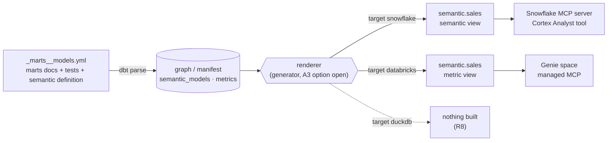
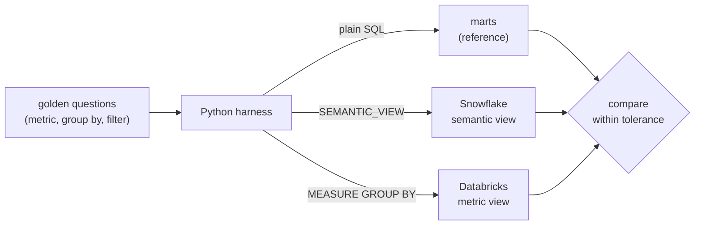

# Design 03: Semantic layer (and a sketch of parity tests)

Status: **revision 1, sketches only.** Section A revisits the phase 3 sketch from [design 02 §A](02-dbt-models.md) using findings checked on 2026-11-16. Section B sketches phase 4. The phase 3 proposal comes in revision 2, after the phase 4 sketch has shown what phase 3 must provide.

Phases in this doc:

- **Phase 3 (to be proposed):** one semantic definition in dbt, rendered as a Snowflake semantic view and a Databricks metric view. This covers phases 2 and 3 of the original plan.
- **Phase 4 (sketch only):** parity tests and CI.
- **Phase 5 (referenced only):** the MCP demo. It matters here because the semantic objects are what Claude will query.

---

## A. Phase 3 sketch, revisited

### A1. Findings since design 02

Each was checked against current docs, package source, or a local experiment on a scratch copy of `dbt_scope` (marked *tested*).

| # | Finding | Effect on the sketch |
|---|---|---|
| F1 | **dbt 1.12 supports the latest semantic YAML spec** ([docs](https://docs.getdbt.com/docs/build/latest-metrics-spec)). Semantic properties sit on the model's own YAML entry: `semantic_model:`, `agg_time_dimension:`, `entity:` and `dimension:` on columns, and `metrics:` with `agg` and `expr`. Measures no longer exist. *Tested:* it parses on dbt-core 1.12.6 with DuckDB. A model can be described in only one YAML file, so a separate `semantic/*.yml` describing the marts fails to parse. | The single definition lives **in `_marts__models.yml`**, next to the column descriptions and tests. The original plan's `models/semantic/*.yml` and its legacy `semantic_models:` / `measures:` syntax are superseded. |
| F2 | *Tested:* `graph.semantic_models`, `graph.metrics` and `graph.saved_queries` can be read from Jinja at run time. In `manifest.json`, a simple metric carries `expr` plus `metric_aggregation_params.agg`, and a ratio metric carries `numerator` and `denominator`. Dimensions without an `expr` map to their column. `meta` (for example synonyms) is preserved. | Both generator options from design 02 A3 can read everything they need. Option B no longer depends on an unverified assumption. |
| F3 | **`Snowflake-Labs/dbt_semantic_view` 1.0.6** passes the model body straight through to `CREATE SEMANTIC VIEW`. Tables are written `alias AS {{ ref(...) }}`. Its options are `copy_grants` and `create_or_alter`. It has no `grants` support, `persist_docs` doesn't apply, and it doesn't read dbt semantic models. ([README](https://github.com/Snowflake-Labs/dbt_semantic_view)) | Something must render the clause text. The package is only the materialization. |
| F4 | **Snowflake semantic views** ([CREATE SEMANTIC VIEW](https://docs.snowflake.com/en/sql-reference/sql/create-semantic-view)): • Names are `table_alias.name`. A bare name works only if it's unique in the view. • Metrics can refer to other metrics. • `WITH SYNONYMS` and `COMMENT` are allowed on dimensions and metrics. • Optional clauses: `AI_SQL_GENERATION`, `AI_VERIFIED_QUERIES`, `COPY GRANTS`. • **`SELECT` on the semantic view alone is enough to query it**, with no grants on the underlying tables. • Queried with `SEMANTIC_VIEW(...)` or with standard SQL using `AGG()`. | Confirms 02A's reader model. Name uniqueness becomes a parity concern (B3). |
| F5 | **dbt-databricks 1.13 `metric_view`** (*read in package source*) runs `CREATE OR REPLACE VIEW ... WITH METRICS LANGUAGE YAML AS $$...$$` and supports dbt's `grants:` config and `databricks_tags`. • YAML 1.1 adds `synonyms`, up to 10 per field. • Measures can refer to other measures with `MEASURE()`. • Window measures are experimental. • Querying needs Databricks Runtime 17.2 or later. ([YAML reference](https://docs.databricks.com/aws/en/metric-views/data-modeling/syntax)) | Ratio metrics translate naturally to `MEASURE(a) / MEASURE(b)`. |
| F6 | **`DATE_TRUNC` returns different types.** It returns `DATE` on Snowflake, but `TIMESTAMP` on DuckDB (*tested*) and Databricks (documented). | Every truncated grain needs an explicit `::DATE`, or the platforms return different types. |
| F7 | *Tested:* the installed MetricFlow 0.213 includes an `msi_to_osi` converter. | The optional OSI export (phase 5) is close to free. |
| F8 | **MCP.** • Snowflake's managed MCP server (`CREATE MCP SERVER`) exposes a semantic view through a `CORTEX_ANALYST_MESSAGE` tool. It supports semantic views only, and a caller needs `USAGE` on the server plus `SELECT` on the view. ([docs](https://docs.snowflake.com/en/user-guide/snowflake-cortex/cortex-agents-mcp)) • Databricks' managed MCP serves Genie spaces, which can include metric views. It's in public preview, a workspace admin must enable it, and Free Edition support is unconfirmed. ([docs](https://docs.databricks.com/aws/en/generative-ai/mcp/managed-mcp)) | Phase 5 needs one extra Snowflake object (the MCP server) and grant. On Databricks, the MCP path depends on account setup (02A V2). |

### A2. The sketch now

The open question from design 02 A3 (Python generator outside dbt, or a dbt-native renderer) is still open. Section B is what should settle it.

---

## B. Phase 4 sketch: parity tests and CI

### B1. Goal

Prove that both platforms give the same answer to the same governed question. The original plan:
- A `golden_questions.yml` file.
- A Python harness that runs each question three ways: plain SQL on the marts, the Snowflake semantic view, and the Databricks metric view.
- Results compared within a rounding tolerance, in a CI job per platform.

### B2. First-pass flow

### B3. What sketching it turned up

Each of these is a problem the first-pass flow hits. Revision 2 turns them into phase 3 requirements.

| # | Problem | Why |
|---|---|---|
| P1 | **Names don't line up across platforms.** | Snowflake names are `alias.name` and return upper case. Databricks names are flat and return lower case. MetricFlow names are `entity__name`. A harness needs a mapping, and the mapping only works if bare names are unique. |
| P2 | **Time grains don't exist on either platform.** | MetricFlow has `order_date__month`, but semantic views and metric views only have dimensions. Grains have to be dimensions with the same names on both platforms, and the same types (F6). |
| P3 | **Ratios can't be compared exactly.** | Decimal division gives a different scale on each engine. Sums and counts of cents are exact everywhere, but ratios need a tolerance. |
| P4 | **NULL groups.** | `return_category` is NULL on non-returned lines. NULLs sort first on Databricks and last on Snowflake and DuckDB, and `NULL = NULL` isn't true in SQL. The comparison has to handle this explicitly. |
| P5 | **Both warehouses must be live in one job.** | A Python harness comparing Snowflake with Databricks directly needs both accounts up at once. The Snowflake trial expires after 30 days, and Free Edition stops compute when a quota is hit. |
| P6 | **Golden questions are unvalidated.** | A typo in a metric name in `golden_questions.yml` fails only at run time, on a warehouse. |
| P7 | **Verified queries need the golden questions inside the semantic view.** | Snowflake's `AI_VERIFIED_QUERIES` is a clause in the view's DDL. Whatever renders the view must be able to read the golden questions. |
| P8 | **Grants disappear on rebuild.** | The Snowflake package uses `CREATE OR REPLACE` by default, which drops grants unless `copy_grants` is set. |
| P9 | **DuckDB can't run the semantic queries.** | But the plain-SQL reference can run there, so it could be computed once, locally, with no accounts. |

### B4. Phase 5 touchpoints

- The **MCP reader** queries the semantic objects only (02A). Phase 5 adds a Snowflake MCP server object, plus `USAGE` on it for `READER`.
- **Synonyms and comments** in the semantic definition are what Cortex Analyst and Genie read. They need to reach both platforms (F4, F5).
- **Golden answers** double as an evaluation set: does Claude, through MCP, give the golden answer?
